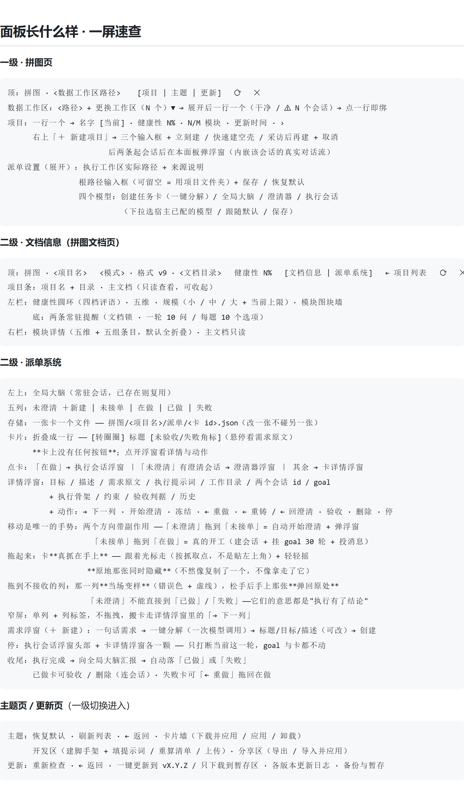

# dsh-puzzle-mode · 拼图模式

> DSH（DeepSeek Harness）插件。**独立的工作台**：不依赖会话，普通会话完全不受它影响。
> 入口在**左上角的全局级**（左侧边栏常驻），面板分两级——
> 一级是拼图页 / 主题页 / 更新页，二级是拼图文档页 / 派单系统页。



**它解决什么**：一段需求从「随口说一句」到「真的做完」，中间要经过澄清、定方案、
派活、验收。拼图模式把这条链子做成一张**五列看板**，并把项目知识沉淀成
**一份主文档 + 若干模块文档**——AI 会忘，文档不会。

- 仓库：<https://github.com/liancha22/dsh-puzzle-mode>
- 主题仓库：<https://github.com/liancha22/dsh-puzzle-themes>（主题**不在插件包里**，在面板主题页点一下从仓库下）
- 最新版：**v2.4.16** · [更新日志](CHANGELOG.md) · [所有版本](https://github.com/liancha22/dsh-puzzle-mode/releases)
- 适配：`@deepseek-ai/cordis ^4.0.1`、`@deepseek-ai/dsh-tools ^0.1.5-alpha.1 || ^0.1.6-alpha.1 || ^0.1.7-alpha.1 || ^0.2.0-rc.1`（照 `package.json` 的 `peerDependencies` 照抄；这是**声明范围**，不是逐版本实测清单）
- **面板逐块说明**：[UI.md](UI.md) —— 每颗按钮、每个区块点了会怎样
- 整份一图流：[`.github/images/ui-tutorial.png`](.github/images/ui-tutorial.png)

---

## ⚠️ 装之前 / 升级之前，先看这四条

1. **装完必须重启客户端才生效**。这次更新不是热加载能带上的，装完请重启 DSH 客户端（该 profile 是 `patchReload: startup`），再刷新页面。
2. **文档兼容性未确认，大概可以直接兼容**。旧格式文档读得出来、不会报错，但这一版没有逐份验过老项目；要迁移用 `puzzle_mode{op:'rebuild'}`（默认只出预览，`apply:true` 才落盘，本项目**不自动备份**）。
3. **全局大脑是持久性会话，别删**。它记着这个项目的主文档、模块索引与执行汇报，删掉会出问题（插件会发现那个会话不在了、另起一个，但**记忆是新的**，而且与它有关的那条线会断）。
4. **澄清器会话是临时会话**。它的产物（标题 / 目标 / 描述 / 执行提示词）写完就已经落在这张任务卡上了，所以它用完就删。⚠️ **不能提前退出**——在它问完之前退出会提前删除，那张卡就没法继续执行了。

---

## 最新版本

### v2.4.16 · 独立工作台 · 两级面板 · 五列派单

拼图插件从「挂在会话上的小工具」变成**独立的工作台**：不再依赖会话，普通会话不再受它影响；
面板入口移到左上角全局级，分两级（一级：拼图 / 主题 / 更新，二级：拼图文档 / 派单系统）；
新增全局大脑、澄清器、执行会话三件套与五列派单看板，执行完自动回写文档。

**改动（最重要）**

1. **拼图插件独立，不再依赖会话**——现在创建普通会话不再受拼图插件影响。
2. **插件面板入口改为左上角的全局级**。面板分两级：一级是**拼图页 / 主题页 / 更新页**，二级是**拼图文档页 / 派单系统页**。
3. **「给 AI 的一句话」全功能暂时删除。**
4. **工作流暂时删除。**
5. **思考熔断、催促、审查等自动注入暂时删除。**
6. **提高了模型使用拼图插件工具的速度。**
7. **改动了拼图文档的面板，UI 现在更大了。**

**新增**

1. **拼图主页**：自由选择工作区，自由选择拼图项目进入。接入设置，可自己修改**全局大脑 / 一键分解 / 澄清器 / 执行**的模型接入，可选择已经在设置里编辑好的模型。
2. **派单系统页**：面板分为五列——**未澄清、未接单、在做、已做、失败**。
3. **全局大脑**：拥有主文档的记忆；检索模块文档、代码能力；拥有拼图文档工具。负责执行后回写文档。
4. **未澄清列新增新建按钮**，点击可弹出需求浮窗。需求浮窗内可填写一句话需求和点击**一键分解**，即可分解为**标题、目标和描述**，点击添加即可成为一张未澄清状态的「任务卡」。
5. **澄清器**：将一张未澄清状态的「任务卡」拖至**未接单列**，则自动弹出澄清器会话浮窗。澄清器继承于全局大脑的上下文并添加此「任务卡」的信息，开始阅读模块文档并开始提问。提问后澄清器模型将这些内容全部写为这个「任务卡」的**执行提示词**并详写目标，随后停止。
6. **执行会话**：未接单状态「任务卡」点击可打开详情，详情页底下有一个**冻结按钮**，点击后即冻结状态。然后就可以将未接单状态「任务卡」移至**在做列**。移至在做列后稍等一会，后台会自动起执行会话，「任务卡」变为在做状态。点击在做状态「任务卡」可呼出当前任务执行会话的浮窗。
7. **执行会话专属工具**：扁平化**写入、编辑、命令**工具，减少了上下文占用、提高了调用速度。
8. **执行完收尾**：执行会话向全局大脑汇报，在做状态「任务卡」变为**已做或失败**状态。
9. **已做状态「任务卡」**点击展开浮窗可**删除任务卡与执行会话**；**失败状态**则能拖回在做列**重做**。

> 更早的版本见 [CHANGELOG.md](CHANGELOG.md)。

---

## 从需求到交付：走一遍

下面这条链子就是插件的全部用法。每一步都可以中途停下——卡会留在它当前所在的列。

### 1. 打开面板

点左侧边栏那颗**拼图**按钮（与「插件」同列，排在它下面）。主区就从会话框换成拼图面板。
面板顶栏右上角的 `✕`（或 `Esc`）关闭它，回到原来那块主区。

### 2. 选工作区，选项目

一级页（拼图页）第一块是**数据工作区**：拼图文档与任务单都存在这里。
点「更换工作区」列出宿主注册的全部工作区，点一行就绑过去；每行右边会标
`干净`（这个工作区还没有会话，推荐）或 `⚠ N 个会话`（AI 在里面干活时，可能把
`拼图/` 与任务单误读成项目内容）。

绑好之后下面就是**项目列表**，一行一个，点一行进二级。
还没有项目就点右上角「＋ 新建项目」——可以**立刻建**（宿主直接建文件夹与文档），
也可以**快速建空壳** / **采访后再建**（起一个新会话让 AI 来建，建的过程在这个面板里弹浮窗给你看）。

> 插件**不会**在你没绑工作区时偷偷退回进程目录——那会把文档写到你看不见的地方。
> 没绑就是没绑，面板会明说。

### 3. 新建一张任务卡

进二级的**派单系统**页。「未澄清」列头有一颗 `＋ 新建`：

1. 在需求浮窗里**写一段需求**，随便写，一大段也行；
2. 点**一键分解**，模型把它理成**标题 / 目标 / 描述**三个字段（都可以改）；
3. 点**创建**，它成为一张「未澄清」状态的任务卡。

> 需求原文会**一字不改地留在卡上**（悬停卡片能看到），分解只是模型对它的解释。
> ⚠️ 「一键分解」每点一次 = **一次模型调用**（要花钱）。

### 4. 澄清器把方案问出来

把这张卡从「未澄清」**拖到「未接单」**，会自动起一个**澄清器会话**并弹出浮窗。

澄清器继承**全局大脑**的上下文（它是从大脑 fork 出来的），手上带着这个项目的
主文档与模块索引，会先读模块文档、再开始提问。你回答完，它把结论写成这张卡的
**执行提示词**并**详写目标**，然后停下。

- 澄清完按浮窗右上角的 `✕` 关掉它——**澄清器会被删除**（它的结论已经写进这张卡了）。
  ⚠️ **不要提前退出**：在它问完之前退出会提前删除，这张卡就没法继续执行了。
  （`✕` 的删除走宿主能力；这台部署没装能删会话的插件时，它会**如实说做不到**，不会偷偷改成归档。）
- 也可以不拖，直接点卡详情里的「开始澄清」——两条路走的是同一套逻辑。
- 已经在澄清中的卡**不会**起第二个澄清器。

> ⚠️ 拖到「未接单」之后**方案还没冻结**（那是真实状态）：这一列的语义是「已冻结成执行方案」，
> 而刚澄清完的卡要你自己点一次「冻结」才算定稿。此时直接拖到「在做」，派单闸门会以
> 「方案还没冻结」拦住并给出出路。

### 5. 冻结，然后拖到「在做」

点「未接单」的任务卡打开**卡详情浮窗**，底下有一颗**冻结**按钮：

- 冻结 = 方案定稿（写下一个冻结时间），**卡不会因为冻结而移动**；
- 冻结的闸门是「**有目标** + **有执行交代**（一段执行提示词或一份步骤骨架）」，
  两样都缺会当场告诉你去补什么；
- 冻完之后，把这张卡**拖到「在做」**——这一步就是**真的开工**：
  后台建执行会话、挂一个目标（默认 30 轮上限）、投出首轮消息，卡变成「在做」。

> 「未澄清」的卡**不能**直接拖到「已做」/「失败」：这两列的意思都是「执行有了结论」，
> 而没澄清、没冻结、没派出去过的卡没有结论。拖过去时那一列会当场变样，硬拖会被拒并说明出路。

### 6. 执行会话干活

卡在「在做」时点它，直接呼出**执行会话浮窗**——它在说什么、改到哪了，一眼能看到。
执行会话有**专属工具**（读 / 写 / 改 / 找文件 / 搜内容 / 跑命令六个），
参数名与宿主约定一致、返回紧凑，所以调用更快、更省上下文。

**执行会话只改代码，不写文档**：拼图文档由全局大脑独占（它手上才有那份文档记忆），
两边都能写的话迟早冲突。

浮窗头部有一颗「停」：它**只打断当前这一轮**，会话、目标、卡都留在原地，待处理的消息也不丢。
（卡详情浮窗里也有同一颗。）

### 7. 收尾：已做 / 失败

执行会话做完会向**全局大脑汇报**，卡自动落到**已做**（标「未验收」）或**失败**：

- **已做**：点卡可以看详情，浮窗里有「验收」（消掉未验收标记，卡不动）与「删除」。
  删除会**连同它的执行会话与澄清会话一起删掉**，不可恢复——所以确认框里会把会话 id 列出来。
- **失败**：把卡**拖回「在做」**= 接着**原会话**继续做（不新建会话），也可以按浮窗里的「← 重做」。
  失败原因会写在卡上：目标被判阻塞（轮次用尽 / 轮次入不了队 / 该轮被判无效 / 模型自报阻塞）、
  会话报错，或者**卡死超时**（挂着目标却不再自动推进超过 10 分钟）。

---

## 面板长什么样

### 一级面板：拼图页 / 主题页 / 更新页

| 页 | 有什么 |
| --- | --- |
| **拼图**（默认） | 数据工作区绑定与工作区选择器、项目列表、新建项目表单、派单设置（执行工作区 + 四个模型） |
| **主题** | 换肤、安装 / 应用 / 恢复默认 / 卸载主题；「开发与分享」区可以建脚手架、重算清单、导出单文件主题包、推送到主题仓库 |
| **更新** | 对比线上版本、看各版本更新日志（每版最多三句摘要）、一键更新（失败自动回退到旧版） |

三页共用顶部同一套分段切换控件，所以在哪一页都能一步切到另一页。

### 二级面板：拼图文档页 / 派单系统页

点一级项目列表里的一行就进二级，顶部有 `← 项目列表` 返回。

| 子页 | 有什么 |
| --- | --- |
| **拼图文档** | 项目条（项目名 + 目录 + 只读看主文档）；左栏是**读数**：健康性圆环、五维、项目规模三档、模块图块；右栏是**细节**：点开图块看模块文档的逐条内容、主文档只读原文 |
| **派单系统** | 五列看板 + 新建任务单浮窗 + 卡详情浮窗 |

**项目规模**（小 / 中 / 大）决定「这个项目写多细」：它直接改各节的条数与字数上限，
存在主文档里跟着项目走，没写就是「中」。点一下当场翻档，写失败会回宿主重读，不留假状态。

**模块图块**：点开读那份模块文档——要点 / 悬而未决 / 已定 / 可复用 / 详细记录**逐条成卡片**，
每组默认折叠，每条带序号与源码出处；超字数或没出处会当场标出来。没建文档的模块标「未建」。

---

## 派单系统

### 五列

```
未澄清 ＋ 新建  |  未接单  |  在做  |  已做  |  失败
```

| 列 | 含义 | 谁把它放进来 |
| --- | --- | --- |
| **未澄清** | 刚建出来、还没澄清过的草稿 | 新建任务卡 |
| **未接单** | 这一列的语义是「方案已冻结、等着派出去」 | 从「未澄清」拖过来会自动起澄清器；澄清完还要点一次**冻结**才派得出去 |
| **在做** | 派单出去的 AI 正在干 | 「未接单」拖到「在做」= 真的开工 |
| **已做** | 执行完成，标「未验收」 | 目标变成完成时自动落这里 |
| **失败** | 目标被判阻塞 / 会话报错 / 卡死超时 | 自动落这里；可以拖回「在做」重做 |

五列从左到右是**单向**的：只能向右流（或同列换排）。左移只开三个口子：
「未接单」（已冻结）→「未澄清」= 重铸新版本；「未接单」（未冻结）→「未澄清」= 接着澄清；
「失败」→「在做」= 接着原会话重做。

**一张卡折叠成一行**：`[转圈圈] 标题 [角标]`。转圈圈只在「在做」且真在跑时出现；
角标只给两种需要你注意的（`未验收` / `失败`）——列名已经说明状态了。
**卡上没有任何按钮**：点开浮窗才是详情与动作，**移动是唯一的触发手势**。

| 点哪张卡 | 开什么 |
| --- | --- |
| 「在做」且有会话 | **执行会话浮窗**（直接看它在干什么） |
| 「未澄清」且有澄清会话 | **澄清器浮窗** |
| 其余（含「在做但没有会话」） | **卡详情浮窗**：目标 / 描述 / 需求原文 / 执行提示词 / 工作目录 / 两个会话 id / 目标 id / 执行骨架 / 约束 / 验收判据 / 历史，外加动作按钮 |

宽屏（≥900px）可以直接**拖拽**搬卡：拖起来的卡**真抓在手上**（跟着光标走 + 轻微摇动），
原地那张同时隐藏（不然像复制了一个）。拖到不接收的列，那一列**当场变样**（错误色 + 虚线），
松手后手上那张**弹回原处**，顶部同时给一句为什么。
窄屏（<900px）变成**单列 + 列标签 + 显式按钮**，不做拖拽——两条路走同一个落位判据，语义不会漂移。

### 三个会话，各管一段

| 会话 | 是什么 | 它做什么 |
| --- | --- | --- |
| **全局大脑** | 一个项目一个，**常驻、持久** | 记着这个项目的主文档；能回读任意模块文档、检索文档条目与代码；手上有完整的拼图文档工具；看执行汇报，执行完负责回写文档 |
| **澄清器** | 一次性、**临时** | 从大脑 fork 出来（继承它的上下文），带着这张卡的信息读模块文档、提问，把结论写成这张卡的执行提示词并详写目标，然后停。它手上有检索文档的窄工具、一个**只改这一张卡**的任务单工具，以及写拼图文档的能力 |
| **执行会话** | 一张卡一个 | 只改代码：六个专属工具，**不给它拼图文档工具**（文档由全局大脑那条线负责）；做完向大脑汇报 |

全局大脑在派单页**左上角**那颗按钮上，已存在就复用（同一个项目不会起第二个）。
**别删它**——它记着这个项目。

### 执行会话的专属工具

| 工具 | 作用 |
| --- | --- |
| `pz_read` | 读文件（可指定起始行与行数） |
| `pz_write` | 整份写入一个文件 |
| `pz_edit` | 把文件里的一段替换成另一段（要求被替换的那段唯一） |
| `pz_glob` | 按模式找文件 |
| `pz_grep` | 在文件里搜内容 |
| `pz_bash` | 跑一条命令 |

参数名与宿主自己的工具一致（`file_path` / `content` / `old_string` / `new_string` / `pattern` / `command`），
所以模型不用猜。它们仍然受**沙箱边界**约束：写入按会话当前的沙箱策略算，
落在工作区之外会收到越界提醒。

---

## 模型与工作区

### 四个模型槽

一级页「派单设置」里可以给四处分别指定模型，每个都可以**跟随默认**：

| 槽 | 用在哪 |
| --- | --- |
| 创建任务卡（一键分解） | 把一段需求理成标题 / 目标 / 描述 |
| 全局大脑 | 常驻会话，回读文档、看汇报、回写文档 |
| 澄清器 | 一次问清一张卡 |
| 执行会话 | 真的动手改代码 |

模型清单来自宿主自己的模型目录——也就是**你在设置里已经配好的那些**，
分组列出，不用自己记 `provider/model` 怎么写。这里改**不会**动你的全局默认模型。

### 两个工作区，别混

| 工作区 | 是什么 | 默认值 |
| --- | --- | --- |
| **数据工作区** | 拼图文档与任务单存在哪 | 必须你绑，没绑就是没绑 |
| **执行工作区** | 派单出去的 AI 在哪改代码 | **默认就是拼图项目文件夹**（不配就能用） |

执行工作区可以在「派单设置」里填一个全局根（这时路径是 `<根>/<项目名>`），
也可以为某个项目单独指定。面板上会显示**实际生效的路径与它的来源**，
而不是只画一个空输入框——留空不代表不能用。

---

## 拼图文档

### 目录结构

```
<数据工作区>/
├── <项目名>/                      ← 一个拼图项目的家（也是执行工作区默认值）
│   └── 拼图/
│       ├── 主文档.md              ← 查找入口，只有四节
│       └── 模块/
│           ├── 登录流程.md
│           └── 数据存储.md
└── 拼图/
    └── <项目名>/
        └── 派单/
            ├── task-0001.json     ← 一张卡一个文件
            └── task-0002.json
```

任务单**一张卡一个文件**：改哪张写哪张，坏哪张只丢哪张，两条并发路径不再互相覆盖。
看板按项目隔离，一个项目的卡不会出现在另一个项目的看板上。

> 旧版本把整个项目的卡装在一个 `派单.json` 里。升级后第一次读看板会自动把它**搬进** `派单/`
> 并把原文件改名成 `派单.json.migrated` 留着（不是删掉），所以你的卡不会在升级时凭空消失。

### 主文档只有四节

`## 模块索引` / `## 源码索引` / `## 工具索引` / `## 坑`。
除这四节外**不写任何内容**——主文档是**查找入口**，细节一律下沉到模块文档。

查找方向固定为 **主文档 → 源码**：每条条目都是「一句话（源码: 文件:行）」，
所以每条都能回查（`## 模块索引` 指向的是模块文档，所以它只限字数、不强制出处）。
字数上限只算「（源码…」之前那句话，**出处不占额度**。

### 模块文档

固定七个小节，顺序即模板顺序：

`## 健康性` / `## 进度` / `## 要点` / `## 悬而未决` / `## 已定` / `## 可复用` / `## 详细记录`

- 条目**不用勾选框、不用图标**：悬而未决与已定靠小节区分；
- **超字数报错、不截断**（半句话落进文档比让你重写一遍更糟）；
- **超条数自动删最旧**，不论旧项有没有澄清；
- 提问这类非重要轮次不写进文档；撤销项直接删除（没有「撤销」小节）。

### 条目规格随项目规模变

主文档 front-matter 的 `规模:` 有三档，同一个项目写多细由它定：

| 档 | 悬而未决 | 已定 | 坑 | 每条的**字数**上限 |
| --- | --- | --- | --- | --- |
| 小 | ≤4 条 | ≤6 条 | ≤10 条 | 与中档相同 |
| 中（默认） | ≤4 条 | ≤10 条 | 不限 | 坑 / 要点 / 悬而未决 / 已定 / 可复用 ≤20 字，详细记录 ≤50 字，三个索引 ≤50 字 |
| 大 | ≤12 条 | ≤30 条 | 不限 | 坑 / 要点 / 悬而未决 / 已定 / 可复用 ≤40 字，详细记录 ≤80 字，三个索引 ≤80 字 |

没写 `规模:` 就是「中」，所以存量文档一个都不用改。
动手写之前先看 `puzzle_mode{op:'read'}` 或 `{op:'size'}` 返回里的 `limits`——那是**这个项目当前**的真实上限。

### 健康性：五维

每一维 0–100、**越高越好**（含「维护系数」——高分表示维护负担轻）：

| 维度 | 含义 |
| --- | --- |
| 任务复杂度 | 模块实际承担的任务量；记下的要点与细节越多越完整 |
| 可拓展性 | 还能往哪里长：悬而未决与已定越多，扩展空间越清晰 |
| 维护系数 | 维护负担轻的程度（高分 = 好维护）：要点写清了才敢改 |
| 代码质量 | 坑与决策的沉淀程度：踩过的坑记下来了，质量才站得住 |
| 可复用性 | 有多少可被别处复用的东西（共享模块、公共接口、抽象） |

**两条取值路径，显式优先**：在模块文档的 `## 健康性` 里一行一维显式写（`任务复杂度: 80`；
写成本型的 `维护成本: 30` 会被自动翻成 `维护系数: 70`）；没写就由文档内容推导。

**这是设计意图，不是缺陷**：健康性反映的是**已经写在文档里的证据**，不是印象分。
空模块五维全 0，不是「看起来还行给 60」。项目健康性 = 各模块健康性的均值，由宿主汇总，
不要在文档里手写总分。

### 文档格式版本与迁移

主文档 front-matter 的 `puzzle:` 是**文档格式版本**，当前是 **v9**。
`op:read` 返回 `outdated: true` 就表示这份文档是旧格式，用 `op:rebuild` 迁移：

```jsonc
{ "op": "rebuild" }                 // 预览：逐文件列出将要改什么，不写盘
{ "op": "rebuild", "apply": true }  // 落盘
```

重建**只改形状**（front-matter 字段、缺失的小节、把旧的合并小节拆成悬而未决 / 已定），
**正文一字不动**。已经写下的超长 / 无出处条目不会被 rebuild 清理——那些要按规格逐节重写。

**本项目不自动备份**，所以默认是 dry-run，预览就是唯一的刹车。
这一版迁移**走工具**（`op:rebuild`）——面板上那条「迁移预览 / 落盘」的入口目前没有接上，别在界面上找它。

> 格式版本改过几次含义，迁移会真的删内容：v9 删掉主文档的 `## 工作流` 整节与 front-matter 的
> `工作流归档:`；v8 删掉 `会话:` / `当前会话:` 两个字段。**迁移后不能回退到旧版插件**——
> 旧版会把「没有 `## 工作流`」读成缺小节，又给你补一个空节回来。
> 另外 `模式:` 这个名字在格式 v5 换过含义：v4 及更早的 `边拼边写` 表示「一轮做完才问」，
> 那个含义现在叫 `写后再拼`；旧文档一律按旧含义读，迁移会改写落盘。

### 文档锁

`write` / `edit` 只要目标是 `拼图/` 下的文件就会被拒绝，**所有模式、所有会话都一样**。
原因：文档形状由插件统一维护（条目限长、条数上限、slug 过滤、路径守卫），
一次普通覆盖就能把这些规则全跳过。只读不受影响，文档就是普通 markdown，随时能看、能拷、能带走。

---

## 下载与安装

**方式一 · 插件管理器（推荐）**

```bash
python3 "$DSH_HOME/plugin-manager.py" github liancha22 dsh-puzzle-mode v2.4.16
```

App 的插件页「添加插件」用的就是它，也支持标签 / 分支 / 子目录：

```bash
python3 "$DSH_HOME/plugin-manager.py" github liancha22 dsh-puzzle-mode main/lib
```

**方式二 · 直接下载附件**

[dsh-puzzle-mode-2.4.16.tgz](https://github.com/liancha22/dsh-puzzle-mode/releases/download/v2.4.16/dsh-puzzle-mode-2.4.16.tgz)
（含全部源码，可以用插件管理器的 `import` 装本地压缩包）

**方式三 · dsh CLI**

```bash
dsh plugin --profile web add github:liancha22/dsh-puzzle-mode
```

> ⚠️ 装完必须**重启该 profile**（`patchReload: startup`），再刷新浏览器页面。
> 本插件**没有任何 npm 运行时依赖**，不需要 `npm install`。

---

## 卸载

```bash
dsh plugin --profile web remove dsh-puzzle-mode
```

或者从 profile 的 `dsh.profile.bundles` 与 `dependencies` 里删掉那两行，重启。
**工作区里的拼图文档与任务卡不受影响**，它们只是普通的 markdown 与 json 文件。

---

## 常见问题

**Q：会不会占满我的上下文？**
主文档就是查找入口，新会话先读入口、按需读一个模块即可，不必通读。
执行会话用的是专属的精简工具，返回也刻意收窄（返回体积与「本次改了什么」成正比，而不是与项目多大成正比）。

**Q：插件会不会影响我的普通会话？**
不会。这一版插件**独立于会话**：普通会话里既没有它的工具，也没有它的规则，
创建普通会话不受任何影响。插件只在**它自己起的子会话**（全局大脑 / 澄清器 / 执行会话，
以及「快速建空壳 / 采访后再建」起的那个建项目会话）里生效。
唯一例外是**文档锁**——任何会话想直接覆写 `拼图/` 下的文档都会被拒，那是数据完整性，
不是「管你的会话」。

**Q：AI 会不会偷偷改我的代码？**
执行会话干的就是改代码，但它是**你派出去**的那一个：目标、执行提示词、验收判据都写在这张卡上，
你随时能点开浮窗看它在做什么，也能随时按「停」打断它当前这一轮。
不想让它动手，就别把卡拖到「在做」。

**Q：健康性分数是 AI 随便打的吗？**
不是。显式写的分数会保留来源标记，没写的由文档证据推导——空文档就是 0。
想让它涨，就真的把内容写进文档。

**Q：我的文档会被锁死吗？**
不会。文档就是普通 markdown，你随时能读、能复制、能带走；只是**写入**要走插件
（为了维持条目规格与路径守卫）。

**Q：面板上为什么找不到「模式」选择器？**
这一版面板里没有它（二级页改版时一起删掉了）。执行模式仍然记在主文档的 `模式:` 里、
也能用 `puzzle_mode{op:'mode'}` 改，只是界面不再画那三颗按钮。

**Q：删掉一张「已做」的卡，会话也一起没了吗？**
是。删除会**连同它的执行会话与澄清会话一起删掉**，不可恢复——所以确认框里会把要删的会话 id 列出来。
只想清掉标记就点「验收」，别点删除。

**Q：为什么卡拖不过去？**
只能向右移（或同列换排）。左移只开三个口子，见上面「五列」。
「未澄清」不能直接拖到「已做」/「失败」，拖过去时那一列会当场变样；
「未接单」没冻结就拖到「在做」也会被拒，并告诉你先去详情浮窗点「冻结」。

**Q：点「一键分解」没反应 / 报错？**
先看浮窗里的红字——它会说明是预算不够、模型没返回 JSON，还是这台部署读不到模型目录。
「一键分解」是**一次真实的模型调用**，会花钱，所以按钮在忙碌期间是禁用的，别连点。

**Q：全局大脑在哪？能删吗？**
在派单系统页**左上角**那颗「全局大脑」按钮上，点一下呼出浮窗。它是**常驻会话**，同一个项目已存在就复用。
**别删它**——它记着这个项目的文档与执行汇报。

**Q：面板能打开，但缩在左上角 / 文字重叠 / 全透明？**
这是**样式没生效**，不是功能坏了。面板顶部会显示一行自检：

```
puzzle-style-diag applied=<真值> rules=<条数|null> inset=… color-mix=… backdrop=… min()=… ua=…
```

把这一行发回来即可定位（`applied=false` 且 `rules=null` 说明样式表根本没进文档，
多半是 CSP 或别的插件清了样式）。

**Q：装上了但提示不兼容 / 根本没生效？**
先确认两件事：① 你的 DSH 版本落在上面写的 `peerDependencies` 范围里；
② **重启过客户端**——这一版不重启不生效。

---

## 本版暂时没有的 / 已知限制

诚实列一下这一版**没有**的东西，免得你去找：

- **「给 AI 的一句话」全功能**：暂时删除。
- **工作流**：暂时删除。主文档的 `## 工作流` 第五节、`op:workflow` 与面板上的工作流图块一起退场，
  文档格式 v9 起主文档只剩四节。
- **思考熔断、催促、审查等自动注入**：暂时删除。审查（`op:audit`、可执行修复清单、五维真实值、
  面板上的审查块）整体移除。
- **「只拼不写」的越权拦截目前是关闭的**：模式仍然写在主文档的 `模式:` 里、也能用
  `puzzle_mode{op:'mode'}` 改，但选它**不会真的拦住写动作**。**文档锁不受影响**，
  继续拦「直接改拼图文档」。
- **面板上没有模式选择器**（见上面那条 FAQ）；面板上也没有「迁移预览」入口，迁移走
  `puzzle_mode{op:'rebuild'}`。
- 与 `dsh-infinite-gen-5` 同装时按契约共存（本插件提示段默认段序 `10120`，小于对方的末位锚点
  `10150`，两侧各自声明同一组数字并双向核对）。详见 [COMPAT.md](COMPAT.md)。

---

## 致谢

按时间倒序，记下**具体做了什么**——名字后面不是客套，是可回查的改动。

- **[@SunsetRNE](https://github.com/SunsetRNE)** ·
  [PR #2](https://github.com/liancha22/dsh-puzzle-mode/pull/2)（已合并，随 v0.19.8 发布）：
  发现当时的测试在文档格式大改之后整片脱节（三红一绿），把三个测试文件对齐到现行实现
  （+201 / −180），并给出三条建议——后来补上的「断言引常量 / 格式契约测试 / 发版门禁」正是接着这三条做的。
  他还在复刻仓里做出了跨插件共存契约那一层，并把它并入主线。

发现 bug、提 PR、纠正文档都算。这个项目**没有** `CONTRIBUTORS` 文件——名单就在这里，
`git log` 是第二份（提交作者身份原样保留）。

---

MIT License · 作者 [liancha22](https://github.com/liancha22)
