# 面板 UI 说明 · 每个地方有什么用

> 对应 v2.4.16。面板是**主区里的工作台**（左侧边栏常驻按钮点开），不再是输入框旁的浮层。
> 本文只讲 **UI 上有什么、点了会怎样**；安装、模式语义、文档规格见 [README](README.md)。
> 每节的图是**照着本文件渲染**出来的（`node tools/render-tutorial.mjs`），
> 与正文同源，改完正文重跑一次即可——不存在「图与文字对不上」的中间态。
> 整份一图流：[`.github/images/ui-tutorial.png`](.github/images/ui-tutorial.png)
> （适合存档或整份转发；逐节阅读请直接看各节自己的图）。

### 开始之前：四条要知道的

| # | 事项 | 说明 |
| --- | --- | --- |
| 1 | **装完要重启客户端** | 插件装好（或「一键更新」装好）之后要**重启该 profile** 才生效，然后刷新浏览器页面。面板自己的更新页也会这么提示。 |
| 2 | **文档兼容性未确认** | 旧文档（格式 v8 及更早）能读出来，但**没有逐版本在真机上验证过**。二级页副标题会标出「（旧格式，建议迁移）」，迁移走 AI 调 `puzzle_mode` 的 `op:rebuild`（默认只出预览，`apply:true` 才落盘）。⚠️ 迁移到 v9 会**真的删掉**旧文档里那些已经取消的小节与字段（例如早先的 `## 工作流`），**不能回退**——动手前自己备份。 |
| 3 | **全局大脑是持久会话，别删** | 一个项目一个，它记着这个项目的主文档与已定事实，执行完成的汇报也投给它。删掉它 = 这个项目的记忆没了。面板上它的浮窗右上角 ✕ **只收起、不删**。 |
| 4 | **澄清器是临时会话** | 它问完就把结论写回任务单，所以浮窗的 ✕ 会**把这个澄清子代理删掉**。注意：DSH 本身没有「临时会话」这种东西，会话一律持久、一律进侧边栏；这里说的「临时」指**用完即删**。 |

---

## 1. 入口按钮

**位置**：左侧边栏常驻按钮，注册在宿主的 `sidebar.panellist` 上，id 是 `puzzle`，
排在宿主「插件」按钮**下面**（注册顺序 `10`）。

| 元素 | 含义 |
| --- | --- |
| 🧩 | 图标，插件自己内联画的（零外部资源）；文字「拼图」由宿主按注册时的 `label` 渲染 |
| `拼图` | 可见文字，同时也是无障碍名称与悬停提示 |
| 高亮 | 只在**一级拼图页**与**二级**时点亮；停在主题页 / 更新页时**不高亮** |

点一下 = 让主区从会话框**换成拼图面板**（走宿主的 `layout.selectPanel('puzzle')`）。
面板**没有「打开」这个状态**：它住在主区槽位里，宿主不渲染它就压根不挂载，
所以它自己藏不掉自己——关闭必须走宿主（见下一节）。

### 与旧版的两处结构性差别

| 项 | 旧版 | 现在 |
| --- | --- | --- |
| 入口 | `conversation.input.left`（输入框左边那颗小按钮） | `sidebar.panellist`（侧边栏常驻） |
| 面板 | `shell.overlay`（全屏浮层 + 遮罩） | `main`（**主区本身**，keyed 槽位） |
| 按钮上的百分比 | `🧩 拼图 62%`（项目健康性） | **没有了**——面板不绑会话，第一屏是项目列表 |

侧边栏那颗按钮的 id 与主区面板的 `key` **必须同名**：侧边栏靠同名配对找面板，
两处不一致点一下就抛错；复用宿主的 `plugins` 则会把宿主的「插件」按钮整个顶掉，
所以必须用新 id。

**主题常驻**：这颗按钮一直显示，所以主题 CSS 在按钮挂载时就拉一次、并跟着主题变化重挂——
不进面板也能看到按钮换色。

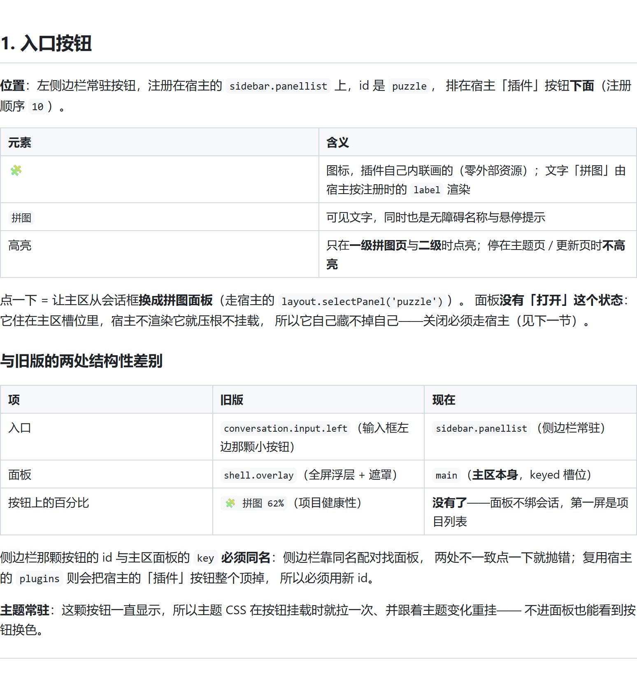

---

## 2. 一级页（拼图页）

第一屏就是**这个数据工作区里的拼图项目列表**。一级页是**单栏**，纵向一行一个项目。

### 顶部

| 位置 | 内容 |
| --- | --- |
| 标题 | `拼图`；副标题是**当前数据工作区路径**（未绑时写「还没绑定数据工作区」） |
| 分段切换 | `项目` / `主题` / `更新`——三页共用同一个控件，所以在任何一页都能一步切到另外两页（见 [§10](#10-主题页与更新页)） |
| `⟳` | 刷新：重拉工作区绑定 + 项目列表 |
| `✕` | 关闭面板（`Esc` 同效） |

点「主题」会顺带拉主题清单与主题仓库状态；点「更新」会立刻对比线上版本并拉更新日志与暂存清单。
**一级页不轮询**（只有二级页每 8 秒拉一次状态），所以列表不会自己跳。

### 数据工作区区

标题是 `数据工作区` + 一颗计数徽标（`已绑定` / `未绑定`），下面一行等宽小字是路径
（未绑时写「（还没绑定）」），再下面一句说明：

| 状态 | 说明句 |
| --- | --- |
| 已绑定 | 拼图项目文档与任务单都存在这个工作区里。 |
| 未绑定 | **没绑就是没绑**——插件不会退回进程目录（那会把文档写到你看不见的地方）。 |

**工作区选择器**：默认**折叠**，只有一颗 `更换工作区（N 个）▼`（展开后变 `收起 ▲`）。
展开后列出宿主注册的**全部**工作区，一行一个，当前绑定的那行高亮；每行右边一颗状态，
判据是**这个工作区里有没有会话**：

| 状态 | 什么时候出现 | 悬停说明 |
| --- | --- | --- |
| `干净`（绿） | 该工作区没有会话 | 这个工作区还没有会话，是存放拼图数据的好地方 |
| `⚠ N 个会话`（黄） | 该工作区已有 N 个会话 | AI 在里面干活时，可能把拼图文档与任务单误读成项目内容 |

**当前会话所在的那个工作区会排在第一行并标 `当前会话`**（只置顶、只标注，**不会自动绑**——
绑定是写盘动作）。点任意一行即绑过去，绑完自动收起列表。

两条降级路径：拿不到宿主的工作区快照时，退成**手填绝对路径**的输入框 + 一颗 `绑定`；
宿主一个工作区都没注册时，只显示「宿主还没有注册任何工作区。」

### 项目区

标题 `项目` + 计数徽标；右上角一颗 `＋ 新建项目`（**未绑工作区时禁用**）。

一行一个项目，每行是：

```
名字  [当前]     健康性 62%  ·  3/5 模块  ·  2026-10-13 00:00:00        ›
```

| 元素 | 含义 |
| --- | --- |
| 名字 | 项目名（= 工作区里的文件夹名） |
| `当前` 徽标 | 这就是「面板当前打开的项目」；只有一行有 |
| `健康性 N%` | 项目健康性（各模块五维的均值，由宿主汇总） |
| `N/M 模块` | 已建文档的模块数 / 总模块数 |
| 更新时间 | 文档最近一次写入时间 |
| `›` | 进二级的箭头 |

悬停能看到 `进入「名字」：<模式> · 健康性 N%`。点一行 = 进二级，并把这一行设成
**面板当前打开的项目**；成功后就地切视图，**不等 8 秒轮询**。

**两种空态**（文案与入口完全不同）：

| 场景 | 图标 | 标题 | 说明 |
| --- | --- | --- | --- |
| 未绑数据工作区 | 网格 | 先绑定一个工作区 | 绑好之后这里会列出那个工作区里的全部拼图项目。 |
| 已绑但没有项目 | 网格 | 还没有拼图项目 | 点右上角「＋ 新建项目」建一个。 |

列表还在拉的时候画三行骨架屏。

### ＋ 新建项目（内联表单）

点右上角那颗 `＋ 新建项目` 就地展开，**不多一层导航**：

| 控件 | 含义 |
| --- | --- |
| 项目名 | **会成为工作区里的文件夹名** |
| 模块名，逗号分隔 | 每个模块一份文档；可留空 |
| 一句话目标 | 写进主文档；可留空 |

四颗动作按钮：

| 按钮 | 它做什么 |
| --- | --- |
| `立刻建` | 直接落盘：文件夹 + 主文档 + N 份模块文档（本地直建，**不起会话**） |
| `快速建空壳` | 起一个会话，让 AI 自己 `op:init`（不采访）；起会话期间按钮显示 `正在起会话…` |
| `采访后再建` | 起一个会话，先问清表单没填的部分再 `op:init` |
| `取消` | 收起表单 |

后两条要起会话，所以起会话期间整组禁用（防连点造出多个会话）；起完**在这个面板里弹一个浮窗**，
让你看着它做（会话本身也会进侧边栏）。

⚠️ **项目名必须填**：三颗按钮都以它为落点（文件夹名）。没填就点，表单上方会
出现一行红字「请先填项目名（它会成为工作区里的文件夹名）」——**不是没反应**，
见下面「一级页还会出现的三行提示」。

### 派单设置区（可展开）

默认收起，标题右侧一颗 `展开` / `收起`。收起时只留一句「执行工作区（默认就是项目文件夹）与四个模型（分解 / 大脑 / 澄清器 / 执行会话）在这里配。」
展开后是两组控件：

**执行工作区**——派单出去的 AI 在哪个目录里改代码。

**默认就是拼图项目文件夹**（`<数据工作区>/<项目名>`），**不配也能用**。

| 控件 | 作用 |
| --- | --- |
| 实际路径那一行 | 显示**当前实际生效**的目录（不是输入框里那个值） |
| 来源说明 | `默认：拼图项目文件夹（不配就是这样）` / `按你填的全局根 + 项目名推导` / `你为这个项目单独指定了目录` / `拼不出来——先绑数据工作区，并打开一个项目` |
| 根路径输入框 | 全局执行工作区根路径（绝对路径）；**可留空**，留空 = 用项目文件夹 |
| `保存` | 存成全局档：每个项目的代码目录 = 根 + 项目名（自动推导）；留空保存 = 回到默认 |
| `恢复默认` | 只在填过全局根时出现，清掉它回到项目文件夹 |
| 单项目覆盖一行 | 已有覆盖时列出 `名字 → 路径；…` |

**四个模型**——创建任务卡（一键分解）/ 全局大脑 / 澄清器 / 执行会话，四处各自可选、互不牵连。

| 元素 | 作用 |
| --- | --- |
| 下拉 | 选项来自**宿主设置里已配置、且当前可路由**的模型；第一项是 `跟随全局默认模型`（已配默认时写成 `跟随全局默认（provider/model）`）；当前值不在目录里时会补一项 `xxx（不在目录里）` |
| `保存` | 存下这一处的选择；选 `跟随全局默认模型` 再保存 = 清掉这一处 |
| `跟随默认` | 只在已配置时出现，清掉这一处，恢复成跟随全局默认模型 |
| 读不到目录时 | 下拉换成一句红字「读不到模型目录，无法选择：<原因>」，`保存` **禁用**（不写一个无法核对的字符串） |

这里改**不会**动你的全局默认模型（走 `installModelSelection`，不是 `session/selectModel`）。

### 一级页还会出现的三行提示

| 样式 | 触发条件 | 你要做什么 |
| --- | --- | --- |
| 红字（error） | 一级页的动作被拦下或失败 | 照那句话改（最常见：项目名没填） |
| 蓝字（notice） | 一次性说明，如「项目已存在，**没有改动绑定**」 | 通常只需知道，不必处理 |
| ⚠️ 样式自检 | 样式表没生效（`applied=false`） | 把那一行 `puzzle-style-diag …` 发回作者 |

样式自检那一行长这样：
`puzzle-style-diag applied=<真值> rules=<条数|null> inset=… color-mix=… backdrop=… min()=… ua=…`
它是「面板能开但没样式」的唯一可靠线索——老 WebView、CSP、别的插件清样式，
症状都一样，靠猜分不出来。一级页也渲染它：第一屏最容易让人以为「插件坏了」。

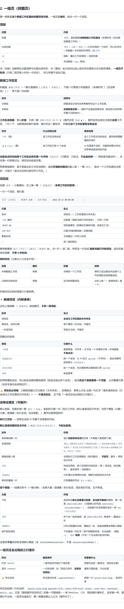

---

## 3. 二级页（两个子页）

点一级页里的一行项目就进二级。二级分**两个子页**，切换控件在顶部。

### 顶部

| 位置 | 内容 |
| --- | --- |
| 标题 | `拼图 · <项目名>`；没打开任何项目时只有 `拼图` |
| 副标题 | `<模式> · 格式 v<版本> · <文档目录>`；旧格式会追加「（旧格式，建议迁移）」；没打开项目时写「这个工作区里还没有打开任何项目」 |
| 右上 | `健康性 N%`（**窄屏 <900px 隐藏**，省空间） |
| 分段切换 | `文档信息` / `派单系统` |
| `← 项目列表` | 回一级（`Esc` 同效）。它**不改「当前打开的项目」**，只是退出二级视图 |
| `⟳` | 刷新：状态 + 项目列表 + 主文档**一起重拉** |
| `✕` | 关面板（`Esc` 先回项目列表） |

切到「派单系统」时**按需拉看板**：它要读盘，不进 8 秒轮询——你停在「文档信息」子页时它根本不读。
子页选择会**记住**：切走再切回、关掉面板再打开，仍停在原来那一页（状态不在组件里）；
浏览器整页刷新会回到「文档信息」。

### 二级里有什么、没有什么

二级只有**两个子页**与顶部那一条项目信息，**没有**这些东西：

| 项 | 说明 |
| --- | --- |
| 主题 / 更新入口 | 它们是面板级的东西，在一级做分段切换 |
| 换项目入口 | 走「← 项目列表」→ 点另一行；二级里没有下拉 |
| 执行模式切换 | 三种模式（`只拼不写` / `写后再拼` / `边拼边写`）写在主文档 front-matter 的 `模式:` 里、也显示在副标题上，要改就让 AI 调 `puzzle_mode` 的 `op:mode` |
| 「交给 AI 的动作」 | 那些按钮（建模块文档 / 接续会话 / 迁移重构等）都不在面板上；要做什么就直接跟 AI 说 |
| 会话绑定 | 面板不绑会话，主文档 front-matter 里也没有 `会话:` / `当前会话:` 两个字段 |
| 全局开关 | 本会话拼图模式、固定收尾问都不在面板上（后者仍可由 AI 调 `op:settings` 改） |

二级页因此只有**两栏**：一栏是「现在什么状态」，一栏是「具体内容是什么」。

### 两个子页的分工

| 子页 | 一句话 | 详见 |
| --- | --- | --- |
| **文档信息** | 两栏工作台：左＝读数（健康性 / 五维 / 规模 / 模块），右＝细节（模块详情 / 主文档） | [§4](#4-拼图文档页) |
| **派单系统** | 五列看板：把一段需求变成任务卡并推着它走 | [§5](#5-派单系统页) |

`Esc` 的层级顺序：浮窗 → `主题` / `更新` → 回项目列表；二级 → 回项目列表；项目列表 → 关面板。
「关面板」走宿主的 `layout.selectPanel(null)`——拿不到 layout 服务时退回「回列表页」，
至少是一个可见的变化，比按了没反应好。

读取失败时**保留两栏骨架**，只在一栏里放一条红条——只弹一个居中红条会让人以为面板坏了，
而保留布局能让人一眼确认「面板还在，只是这次读取失败」。首屏数据没到时画骨架屏。
样式自检那条告警（同 [§2](#2-一级页拼图页)）二级页也渲染，位置在两栏上方。
两栏上方还会出现一次性说明（蓝字）与「还没绑定数据工作区」的黄字警告。

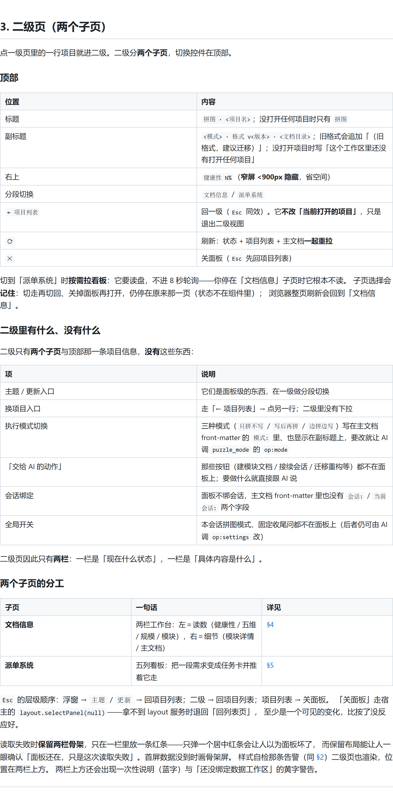

---

## 4. 拼图文档页

二级的「文档信息」子页。**两栏**：**左＝现在什么状态 · 右＝具体内容是什么**。

### 项目条

顶部一条横排的**项目条**，装着这个项目的身份信息：

| 元素 | 内容 |
| --- | --- |
| 项目名 + 文档目录 | 只显示**当前打开的项目**；换项目走「← 项目列表」，二级里**不给下拉**——那会长出第二条换项目路径，两条路径迟早有两种语义 |
| `主文档` | 只读查看主文档原文（含 front-matter 与四节）；再点收起，**每次展开都重新拉**——文档可能已被 AI 改过 |

### 左栏 · 读数

| 区块 | 内容 |
| --- | --- |
| **项目健康性** | 大圆环 + 一句评语 + 来源说明 |
| **五维** | 五条横条，标题标 `跨模块均值 · 声明值` |
| **规模** | 三颗按钮 `小` / `中` / `大`，标题标 `<当前档> · 决定条目上限` |
| **模块** | 图块墙 |
| （常驻提示） | 两行说明，见 [§13](#13-两条常驻提醒) |

**健康性评语分四档**（刻意粗——它只回答「现在该不该慌」）：

| 分数 | 评语 |
| --- | --- |
| ≥85 | 文档证据充分，可以直接动手 |
| ≥70 | 基本可用，有若干维度缺证据 |
| ≥50 | 证据偏薄，改动前先补文档 |
| <50 | 证据很少，建议先补要点与决策 |

下面一行写清分数来源：来自文档里写下的证据（要点 / 详细记录 / 悬而未决 / 已定 / 坑）——
空文档就是 0，不是印象分。

**五维**是 `任务复杂度` / `可拓展性` / `维护系数` / `代码质量` / `可复用性` 五条横条，
每维一个百分比；数值由宿主汇总，UI 不自己算。**维护系数高分 = 维护负担轻**。

**规模三颗按钮**决定「这个项目写多细」——它直接改各节的条数与字数上限：

| 档 | 悬停说明 | 当前上限那一行的效果 |
| --- | --- | --- |
| `小` | 小项目：条目收紧（悬而未决 4 / 已定 6，坑 10 条） | 悬而未决 ≤4 · 已定 ≤6 · 坑 ≤10 |
| `中` | 中项目：默认档（悬而未决 4 / 已定 10，坑不限） | 悬而未决 ≤4 · 已定 ≤10 · 坑 不限 |
| `大` | 大项目：条目放宽（悬而未决 12 / 已定 30，坑不限；字数也放宽） | 悬而未决 ≤12 · 已定 ≤30 · 坑 不限 |

「字数也放宽」是实打实的：`大` 档把要点 / 悬而未决 / 已定 / 可复用 / 坑 从 20 字放到 40 字，
详细记录 50 → 80 字，模块索引 / 源码索引 / 工具索引 50 → 80 字；`小` 与 `中` 的字数上限相同。
（「坑」是**只增不减**的踩坑记录，所以中 / 大两档都不限条数；只有小档收到 10 条。）

点一下**按下即亮**（先本地翻档、再发请求），随后用宿主回的权威值覆盖；
写失败会回宿主重读，不留一个「没写进文档的假态」。档位存主文档 front-matter 的 `规模:`，跟着项目走；
**没写就是「中」**，存量文档一个都不用改。

**模块图块墙**：每块 = 名字 + 健康性条 + 百分比 + `点 N / 悬 N / 定 N`（计数为 0 的那项不显示）。
**点开读该模块详情，再点收起**。没建文档的模块标 `未建`。空态写「还没有模块」并提示让 AI 用 `op:init` 带 modules 一起建。

### 右栏 · 文档与细节

| 区块 | 内容 |
| --- | --- |
| **模块详情** | 点了图块才出现。标题 `模块 · <名> · 健康性 N%`；下面是五维 + 逐条卡片 |
| **主文档** | 只读原文，标题标 `主文档（只读 · 格式 vN）`，旧格式会标 `· 旧格式` |

#### 模块详情的逐条卡片

每条是一张卡片，**一行排开**（不是两行）：

```
①  <条目正文>   lib/client.js:181   [超3字 · 缺出处]
 ↑                ↑                   ↑
序号          出处（等宽小字，     不合规时才出现的胶囊标签
              已去掉「（源码: ）」外壳）
```

- 分组：**要点 / 悬而未决 / 已定 / 可复用 / 详细记录 · 轮汇报**；
- 分组标题带 `N 条 · 每条 ≤20 字 + 出处`（详细记录是 ≤50 字）；
- 分组**没有条目时整组不渲染**（不会出现空标题）；
- **超字或缺出处会当场标出来**：标签转警告色，卡片左边框也转警告色；
- 出处是等宽字体，只显示 `文件:行`。

#### 条目之间一条横线 + 小节默认折叠

**横线**：卡片之间画一条 1px 的线（比卡片边框重一档），**最后一条不画**
（它下面是下一节的标题）。用的是 `::after` 而不是给卡片加 `border-top`——
后者会让第一张顶着一条多余的线（它上面是标题），而「组内只有一条」时又看不到线。

**默认折叠**：五组**默认全部收起**，标题是一整行可点按钮：

```
▸ 要点 · 12 条 · 每条 ≤20 字 + 出处
```

点名字或点计数都能开合，不必精确点到箭头。规则：

- **互不影响**：点开一组不会把别的组收掉，也不会把别的组一起打开
  （「悬而未决」和「已定」常常要对着读）；
- **可逆**：再点一次收起；
- **折叠是视觉的**：卡片仍然渲染在树里，只用 CSS `display:none` 隐藏，
  所以折叠不改变树的内容、只改变可见性。

#### 主文档

只读原文（含 front-matter 与四节），标题标 `只读 · 格式 vN`，下面是文档路径与一个可滚动的原文块。
用只读块而不是可编辑框：拼图文档只能由 AI 通过 `puzzle_mode` 改，面板上开一个可编辑框等于绕过规格。
末尾一行写「只读：拼图文档只能由 AI 通过 puzzle_mode 改，面板不提供编辑。」

> ⚠️ **面板上没有「迁移格式」入口**：二级那一整块（含迁移按钮）已经随三栏改两栏一起删除。
> 要迁移旧文档，让 AI 调 `puzzle_mode` 的 `op:rebuild`——它**默认只出预览**，`apply:true` 才落盘，
> 落盘前请自己备份。

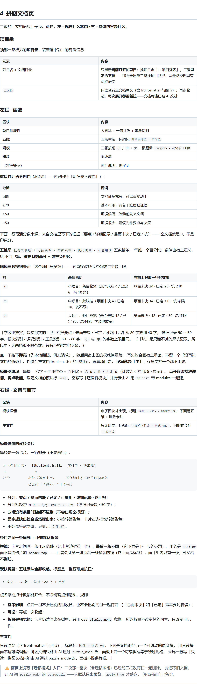

---

## 5. 派单系统页

二级的「派单系统」子页。五列看板，把一段需求变成任务卡、再推着它一列一列往右走。

### 顶部：全局大脑

派单页**左上角**一条：一颗 `全局大脑` 按钮 + 一句说明。点它呼出这个项目的常驻大脑
（第一次点是建会话 + 注入人设 + 投首轮消息，几秒；期间按钮显示 `正在呼出…` 并禁用）。
已经呼出过时按钮显示选中态。说明文字是「常驻会话：带这个项目的主文档（压缩时才刷新），
能回读模块文档、检索条目、看执行汇报。」

一个项目一个大脑；已经存在就复用，不会又建一个。

### 五列

**看板占满整个面板**：五列等高撑满可视区，卡多了**滚那一列**、不滚整页——列头始终可见。

每列是一个**有明确范围的框**：边框比其它区块重一档 + 外圈阴影，
列头一个**状态色圆点** + 一条 3px 的**状态色顶带**
（未澄清＝警告色、未接单 / 在做＝主色、已做＝成功色、失败＝错误色）。

**空列**：列的边框仍是实线、底色与有卡时**完全一样**（五列始终对齐，只有外圈阴影少一层），
列内是一个**垂直居中、与列头文字左对齐**的占位块——一个小图标块 + 两句说明
（「还没有任务单 / 点右上『＋ 新建』写一张」）。

五列从左到右是**单向**的：只能向右流转（或同列换排）。左移只开三个口子，
见下面「卡上的动作」。

```
未澄清  ＋ 新建   |  未接单  |  在做  |  已做  |  失败
```

| 列 | 含义 | 列头 |
| --- | --- | --- |
| `未澄清` | 刚建出来、还没澄清过的草稿 | 列名 + 计数 + 一颗 `＋ 新建`（**新建入口放在这一列**，与列语义一致） |
| `未接单` | 已冻结成执行方案、等着派出去 | 列名 + 计数 |
| `在做` | 派单出去的 AI 正在干 | 列名 + 计数 |
| `已做` | 执行完成，**标「未验收」** | 列名 + 计数 |
| `失败` | 被 block / 会话报错 / 卡死超时 | 列名 + 计数 |

> ⚠️ 「未接单」这一列的语义是「已冻结」，但**刚拖过来的卡可能还没冻结**（那是真实状态）：
> 拖「未澄清 → 未接单」会自动起澄清器（见 [§7](#7-澄清器)），问完还要你点一下 `冻结`。
> 此时直接拖到「在做」会被派单闸门拦下并给出出路。

**能不能移到某一列、移了算什么**，判据全在宿主（`moveVerdict`）——面板不自己写一份：
拖拽时「这一列收不收」的禁跳表由宿主随看板下发，搬列被拒时的理由也由宿主给。
抄一份到客户端就是两套规则，迟早漂移成「高亮说能放、松手却被拒」。

### 一张卡片：折叠成一行

| 元素 | 内容 |
| --- | --- |
| 转圈圈 | 只在「在做」**且真在跑**时出现（读宿主实时状态） |
| 标题 | 卡片的标题；没有时写「（无标题）」；**单行省略**，不换行 |
| 角标 | 只给两种：`未验收`（已做且未验收）、`失败`。列名已说明状态，其余列不挂角标 |
| 悬停 | 显示**用户写的需求原文**（一字未改） |

**卡上没有任何按钮**。目标 / 执行提示词 / goal / 失败原因 / 动作按钮全部搬进**点开后的浮窗**——
移动就是唯一的手势。

### 拖拽（宽屏）

| 行为 | 说明 |
| --- | --- |
| 拖起来 | 浏览器那张原生拖影被藏掉，换成**自己造的一张真卡**：按 `光标 − 抓取点` 定位（所以卡停在你手底下原来的相对位置），并且**轻轻摇**（幅度很小：约 ±2°、位移 1px） |
| 原地那张 | 拖起来那一刻**隐藏**（保留它占的位置，同列的卡不会往上跳），松手后照常出现在新列或回到原位——不然屏幕上同时有两张，看着像复制了一个 |
| 拖到不接收的列 | 那一列**当场变样**（错误色 + 虚线），而不是等你松手才被拒 |
| 松手被拒 | 手上那张卡**沿原路飞回**出发位置再消失；顶部同时给一行红字说明原因 |
| 落点 | **列**接收 drop（不是卡片）：`moveVerdict` 的语义是列与列的流转，没有「同列第几位」 |

两个方向带副作用：**「未澄清 → 未接单」自动开始澄清并弹出澄清器浮窗**；
**「未接单 → 在做」真的派单开工**。其余方向只搬列。

**「未澄清」不能直接拖到「已做」/「失败」**：这两列的意思都是**执行有了结论**，
而未澄清的卡没澄清、没冻结、也没派出去过——它没执行，不该有结论。

> ⚠️ 系统开着「减少动效」时**不摇、也不播弹回**（直接落回原位消失）：
> 那张卡挂在 `document.body` 下、不在插件的作用域子树里，CSS 的
> `prefers-reduced-motion` 通配规则**罩不到它**，所以由 JS 显式判。

### 窄屏（<900px）

变成**单列视图 + 列标签切换 + 显式按钮**：

- 顶部一排列标签（`未澄清 3` / `未接单 1` / …），点标签换列；
- 一次只显示一列，空列写「这一列是空的」/「还没有任务单」；
- **不做拖拽**——搬卡一律走详情浮窗里的 `→ <下一列>` 按钮，规则与宽屏同一个落位函数。

### 点一张卡会开什么（按列分）

| 列 | 点开 |
| --- | --- |
| `在做`（有会话） | **执行会话浮窗**——直接看它在干什么、说了什么 |
| `未澄清`（有澄清会话） | **澄清器浮窗** |
| 其余（含「在做但没有会话」） | **卡详情浮窗** |

「在做但没有会话」是真实状态（手动拖进去的卡），那时**降级到详情浮窗**——
开一个空壳执行会话浮窗比不开更糟。

### 卡详情浮窗

盖在看板上（不是换页），按 Esc 或点遮罩关掉。里面是：

- 顶部徽标：所在列 / `已冻结 vN` / `未验收` / `已验收` / `失败：<code>`；
- 「在做」列多一行实时状态：`执行中（轮 N/M）` / `会话空闲（没在跑，可能等下一轮）` /
  `读不到实时状态（会话可能已经不在了）` / `没有会话——这张卡不是派单出去的`；
- 逐行字段：目标 / 描述 / 需求原文 / 执行提示词 / 工作目录 / 执行会话 / 澄清会话 / goal
  （`goal` 那行写成 `<id>（rev N · 轮 N/M）`）；
- 执行骨架 / 约束 / 验收判据 / 历史（后三者有才渲染；历史一条都没有时写「还没有搬动记录」）。

### 卡上的动作（都在详情浮窗里）

| 动作 | 出现在 | 点了会怎样 |
| --- | --- | --- |
| `→ <下一列>` | 除「已做」外都有 | 往右移一列（下一列由列序算出）。**「未澄清」→「未接单」= 自动开始澄清并弹澄清器浮窗**；**「未接单」→「在做」= 真的派单开工** |
| `开始澄清` | 未澄清 | **起一个固定的澄清器会话**（已经在澄清中的卡复用那个会话） |
| `冻结` | 未接单且**未冻结** | 方案定稿：写 `frozenAt`（**卡不移动**）。冻完才派得出去 |
| `← 重做` | 失败 | 接着**原会话**继续（**不新建会话**），回到「在做」 |
| `← 重铸` | 未接单且**已冻结** | 重铸新版本：带着 v1 重走澄清，冻结后产出 v2 并自动跳回未接单 |
| `← 回澄清` | 未接单且**未冻结** | 接着澄清（本来就是草稿，不产生新版本） |
| `验收` | 已做且未验收 | 消掉「未验收」标记；**卡不因验收而移动** |
| `删除` | 已做 | 删掉卡，**连同它的执行会话与澄清会话**（不可撤销，二次确认里列出会话 id） |
| `看执行会话` | 有执行会话时 | 在浮窗里看那个会话的对话 |
| `看澄清会话` | 有澄清会话时 | 在浮窗里看那个会话的对话 |
| `停` | 有执行会话时 | 停掉这张卡的执行会话：**只打断当前这一轮**，goal 与卡都留在原地（见 [§8](#8-执行会话)） |

其余方向**压根不给动作**——「不能移」用「没有动作」表达，比「点了回弹」清楚。
被拒时宿主会给得出原因与出路：「只能向右移（或同列换排）；左移只开三个口子：
未接单（已冻结）→ 未澄清、未接单（未冻结）→ 未澄清、失败 → 在做。」

浮窗底部一行提示：`移动是唯一的触发手势：把「未接单」移到「在做」= 真的开工。`

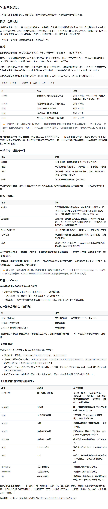

---

## 6. 新建任务单（需求浮窗）

从「未澄清」列头那颗 `＋ 新建` 进。它是一个**浮在看板上的浮窗**（不是换页）——
这样「点创建 → 卡出现在未澄清列」在**同一屏内**可见。按 Esc 或点 ✕ 关掉。

### 两步

**① 写需求**：一个多行文本域，随便写、一大段也行。

| 控件 | 作用 |
| --- | --- |
| `一键分解` | 让模型把需求整理成标题 / 目标 / 描述；分解期间按钮变 `分解中` 并禁用 |
| `✕` | 关掉这个浮窗，回看板 |

> ⚠️ **成本提示**：**「一键分解」每点一次 = 一次模型调用**（要花钱）。
> 它是**一次性的用户主动动作**，与常驻成本不是一回事。
>
> 两条容错：**连点两次，第二次作废第一次**（慢的那次回来不会覆盖你已经改过的框）；
> **失败 / 超时，需求原文不丢**，可以直接重试。

**② 三个框可改**：分解只是「帮你把一段话理成结构」，不是「一次生成不可动」。

| 框 | 占位 | 说明 |
| --- | --- | --- |
| 标题 | 标题（一句话） | 唯一的必填项；空着时 `创建` 禁用（悬停说「标题不能为空」），正在落卡时也禁用 |
| 目标 | 目标（可判定，将来直接当 goal） | 将来直接当 goal 的目标 |
| 描述 | 描述（做什么 / 边界 / 约束） | 背景与边界 |

模型没给出的字段会**列出来并提示自己补**：「模型没给：标题 / 目标 / 描述，自己补上。」

| 按钮 | 作用 |
| --- | --- |
| `创建` | 落一张卡在**未澄清**列；**不会自动开澄清器**（你可能还要连建几张卡，立刻提问会打断你） |
| `取消` | 关掉这个浮窗 |

需求原文**原样留在卡上**（`sourceRequest`）——分解产物是模型的解释，原文才是事实；
任何时候都能回头看当初到底要什么。写了需求时浮窗底部会多一行说明这件事。

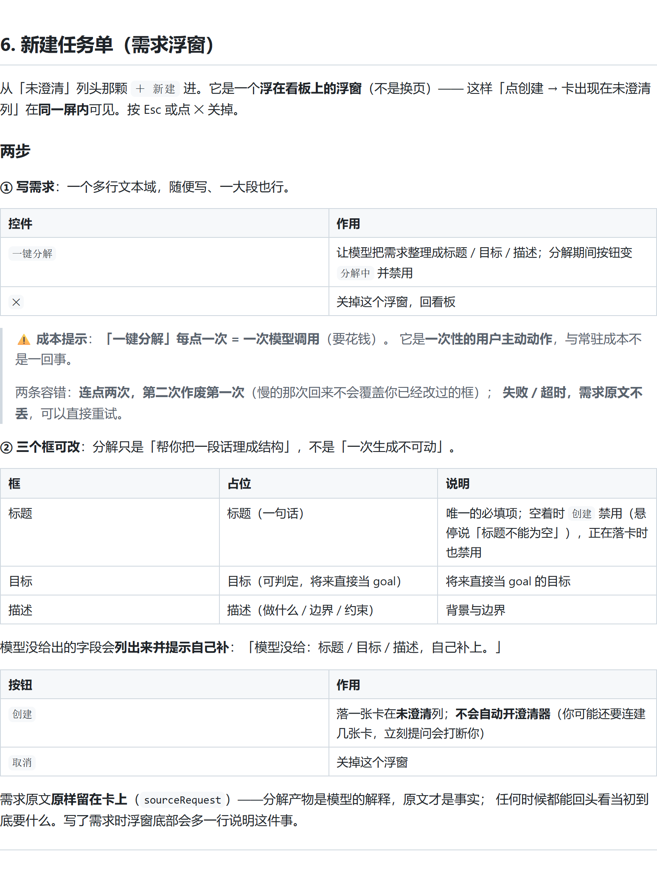

---

## 7. 澄清器

澄清器是**固定人设**的会话，专门把一张「未澄清」卡问成一份可执行、可验收的方案。

### 怎么起它

| 入口 | 行为 |
| --- | --- |
| 把「未澄清」卡**拖到「未接单」列** | 宿主起澄清会话 → 卡搬到「未接单」→ 面板**当场弹出澄清器浮窗** |
| 卡详情浮窗里的 `开始澄清` | 起澄清会话，**卡不移动**（还是「未澄清」） |

已经在澄清中的卡**复用**原会话，重复拖不会造出两个澄清器。已经冻结过的卡不能再澄清
（要改就把它拖回「未澄清」，那是重铸新版本）。

### 它手上有什么

| 能力 | 说明 |
| --- | --- |
| 继承全局大脑的上下文 | 它从**全局大脑**分叉出来，继承事件日志——所以它开口就知道这个项目已定了什么。没继承上时浮窗会红字明说「这个澄清器**没有**从全局大脑分叉——它没有继承上文。」 |
| 主文档全文 + 模块索引 | 开口就带着；能检索模块文档 |
| 写回任务单 | 它有一个专属的写回工具，把结论写成这张卡的字段 |

### 它问完之后

澄清器把问出来的东西**全部写成这张卡的执行提示词、并详写目标**（还可以补标题与描述），
写回之后**这一轮澄清就结束**。卡上你会看到：

| 字段 | 来自澄清器 |
| --- | --- |
| 执行提示词 | **必填**——它是执行会话唯一的起点，不能空着写回 |
| 目标 | 一句话、可判定；它将来直接当 goal 的目标 |
| 标题 / 描述 | 有就给，没有就保留原来的 |

⚠️ **执行提示词里只有改代码的活**。澄清器自己手上有拼图文档工具，但**执行会话没有**
（v2.4.15 起文档只由全局大脑写），所以「回写拼图文档 / 更新模块文档」这类步骤
不会出现在执行提示词里——写进去执行会话也做不了。文档由大脑收到执行汇报后回写。

问完你还要在卡详情里点一下 `冻结`（**冻结按钮在「未接单」列**，见 [§8](#8-执行会话)），
方案定稿后才派得出去。

### 浮窗

- 标题是 `澄清器 · 就这一张任务单`，头部还有 `在主区打开`（把会话放到主区看）；
- **✕ = 关掉浮窗并删掉这个澄清子代理**（结论已经写回任务单，留着只会在侧边栏堆积）；
- **Esc = 只收起浮窗**，留着那个会话；
- 会话本身是持久会话，**会进侧边栏**——DSH 里没有「临时会话」这种东西，
  这里的「临时」指的是**用完即删**。

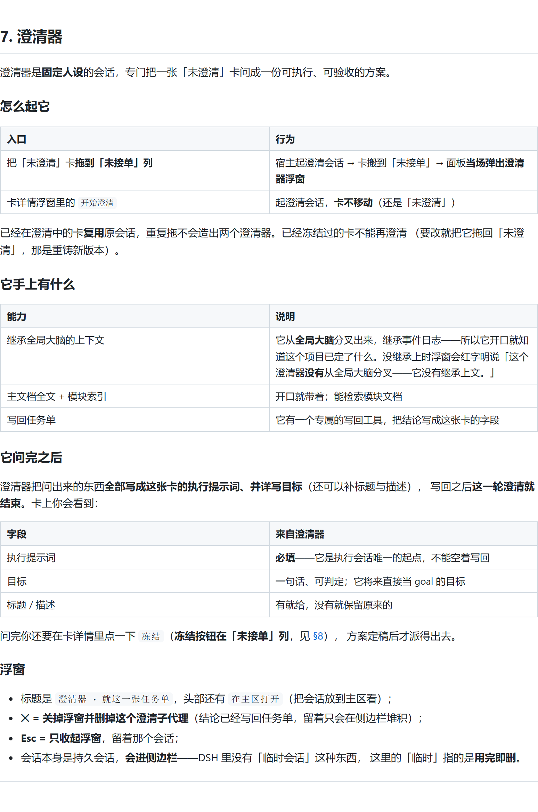

---

## 8. 执行会话

### 从「未接单」到「在做」

1. 「未接单」卡**点开详情** → 底部有 `冻结` 按钮（**只有这一列有**：「未澄清」管澄清，「未接单」管冻结）；
2. 点 `冻结` → 写冻结时间，**卡不移动**。冻结判据是「目标 + 执行交代」两样都有
   （执行交代 = 执行提示词，或结构化骨架至少一步）；缺了会明确告诉你缺什么；
3. **冻结之后**才派得出去：把卡拖到「在做」列，或点详情里的 `→ 在做`；
4. 这一步当场做四件事：建会话 → 拿 agent → 挂 goal（**默认上限 30 轮**）→ 投首轮消息 → 卡搬到「在做」。
   起会话与投消息要几秒，成功后卡就在「在做」列跑起来了（卡片上会出现转圈圈）。

派单失败时**不假装成功**，而且会说清到哪一步了：

| 情况 | 会看到 |
| --- | --- |
| 拼不出执行工作区 | 「派不出去：拼不出执行工作区」——通常是**还没绑数据工作区**（默认档 = `<数据工作区>/<项目名>`，拼不出来就连会话都不建） |
| 方案还没冻结 | 「方案还没冻结，不能派出去」+ 出路「打开这张卡的详情，点『冻结』」 |
| 这台部署没有 goals 服务 | 「这台部署没有 goals 服务，派出去也没人驱动它」——这一条**在建会话之前**就查，所以不会留下一个没人管的空会话 |
| 首轮消息投不进去 | 「会话建好了但首轮消息没投进去」+ 点名会话——卡**不搬列**（消息没进去 = 活没派出去），会话已经建出来并记在卡上 |

### 执行会话浮窗

点「在做」那张卡（有会话时）直接打开它，看它在干什么、说了什么。

| 元素 | 说明 |
| --- | --- |
| 标题 | `执行会话`；头部有 `在主区打开` |
| 实时状态 | `运行中（轮 N/M）` / `空闲（轮 N/M）`；拿不到状态时**整颗不显示**（不编「空闲」） |
| `停` | 见下 |
| `✕` | **只收起浮窗，不删会话**：执行会话还在跑（它挂着这张卡的 goal），删掉等于把正在做的活连同上下文一起丢，而卡还停在「在做」成了一个永远没人推的孤儿 |

### `停` 按钮

`停` 有两颗，**同一个动作、同一个请求**：执行会话浮窗头部一颗，卡详情浮窗里一颗
（后者是为「我在详情里看到它还在跑，就想停」这条路径）。

点了会怎样：

| 项 | 结果 |
| --- | --- |
| 当前这一轮 | **打断**（走宿主的 `sessionController.cancel`，契约语义是「取消当前一轮，但不丢待处理的消息队列」） |
| goal | **不动**——不会被清、轮次预算还在（停 ≠ 放弃） |
| 卡 | **不搬列**——它派出去过、现在被你按停，既没做完也没失败，停在「在做」是真实状态 |
| 待处理消息 | 不丢，想接着做再派一次即可 |
| 失败时 | 如实报错（「这张卡没有执行会话，没什么可停的」/「这台部署的 sessionController 没有 cancel，停不了会话」），不假装成功 |

要**结束**这件事，走「移到失败」或（已做后）删卡，那才谈得上清 goal。

### 执行会话的专属工具

执行会话**只改代码**：它装的是六个扁平的 `pz_*` 工具（读 / 写 / 编辑 / 通配 / 搜索 / 命令），
schema 压到最小以减少上下文占用。**它不装 `puzzle_mode`**——拼图文档由**全局大脑**独占写入，
两处都能写冲突是迟早的事。

专属工具越界（写到会话工作目录之外）时会附一句提醒，但**不拦**——真正的写入边界由沙箱负责。
装不上专属工具时会如实标出来（那一轮就用宿主原版工具，功能不受影响、只是贵一点）。

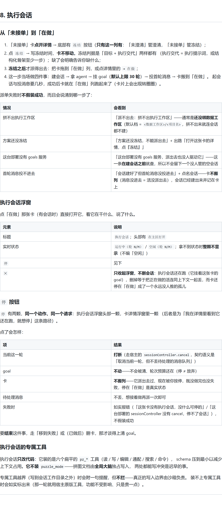

---

## 9. 执行完成与收尾

### 自动流转（不需要你点）

执行会话做完之后自己把 goal 标成完成；宿主据此搬卡、清 goal、向全局大脑汇报。
两条路都通：goal 变更事件（变更即达）+ **每一轮结束时的兜底判定**——
所以模型万一忘了标完成，那一轮结束时也会按「报错 / 卡死超时」等判据收敛。
面板靠 8 秒轮询发现卡换了列（只在**真的从「在做」换出去**时弹一次消息，不会每 8 秒重复报同一件事）。

| 优先级 | 条件 | 落位 |
| --- | --- | --- |
| 1 | goal 相位 = `complete` | 已做（标未验收） |
| 2 | goal 相位 = `blocked` | 失败（原因取 4 种 code 之一：轮次用尽 / 入队失败 / 该轮被判无效 / 模型自报阻塞） |
| 3 | 会话报错且**没**完成 | 失败（`agent-error`） |
| 4 | goal 还在跑但驱动已停、会话也不运行，持续超阈值 | 失败（`stalled`，默认 10 分钟） |

`complete` 优先级最高：已经做完的卡不该因为一条残留 error 被搬进失败列。
失败（`failed`）**不清 goal、也不汇报**——失败不是结束，你可能要接着重做。

### 完成时的收尾

| 动作 | 说明 |
| --- | --- |
| 搬卡 | 「在做」→「已做」，并标「未验收」 |
| 清 goal | 清掉挂在这张卡上的 goal（轮次预算收工） |
| 汇报全局大脑 | 投一条执行汇报给它，由它按自己的职责回写文档——**文档只由全局大脑写** |

三件事**互不牵连**：搬卡是本地写盘（必成），清 goal 与汇报走宿主服务（可能失败）。
汇报失败只记故障日志、**不回滚搬卡**——卡已经搬好了，不会因为投递失败又跳回「在做」。
项目还没有全局大脑时，汇报这一步**跳过**（不是失败）。

### 已做 / 失败之后你能做什么

| 卡在哪 | 能做什么 |
| --- | --- |
| 已做（未验收） | `验收`（消掉「未验收」标记；**卡不因验收而移动**）、`删除`（删卡 + 连它的执行会话与澄清会话，不可撤销，二次确认里列出会话 id） |
| 已做（已验收） | `删除` |
| 失败 | `← 重做`（接着**原会话**继续，不新建会话，回到「在做」）、`删除` 不行（只有「已做」能删） |

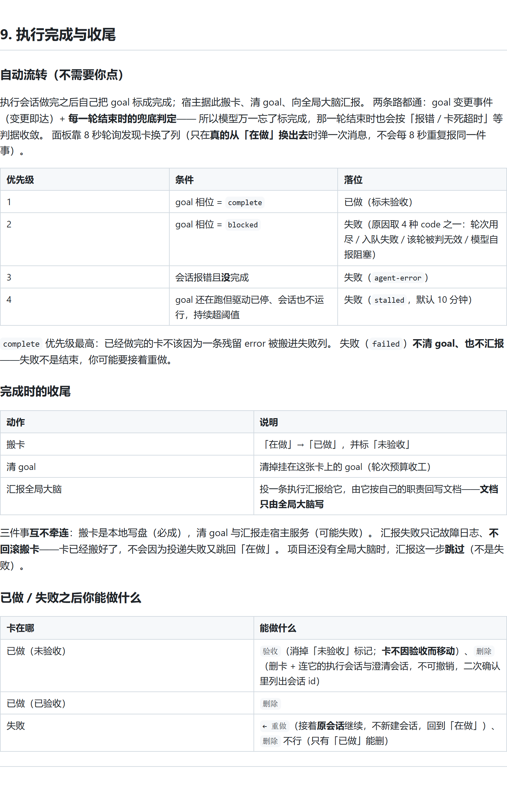

---

## 10. 主题页与更新页

两者都在**一级页**用分段切换进入（**不在二级**）：它们是面板级的东西——
全局皮肤、插件自身版本——跟「哪个项目」无关。三页共用同一个分段控件，
所以在任何一页都能一步切到另外两页；进去后 `Esc` 或 `← 返回` 回项目列表，
关整个面板用右上角那颗 `✕`。

### 主题页

主题**不在插件包里**——包里只有代码，皮肤点一下从
[dsh-puzzle-themes](https://github.com/liancha22/dsh-puzzle-themes) 现取。

| 位置 | 内容 |
| --- | --- |
| 顶栏 · 左 | 标题 `主题` + 当前主题（默认皮肤时写「当前：液态玻璃（内置默认 · 随宿主明暗）」） |
| 顶栏 · `恢复默认` | 常驻一颗（不跟列表滚），回到内置的液态玻璃，**不卸载**已下载的主题；现在就是默认时禁用 |
| 顶栏 · `刷新列表` | 重新从主题仓库拉清单；拉取中变 `拉取中…` |
| 顶栏 · `← 返回` | 回项目列表（`Esc` 同效） |
| 卡片墙 | 每张卡：主题主色块 + 名字 + 作者/版本 + 一句话说明 |
| 卡片 · 未装 | 一颗 **`下载并应用`**——下载、校验、落盘、应用，一步到位 |
| 卡片 · 已装 | **`应用`**（不联网；已在用则禁用）+ **`卸载`**（危险色） |
| 开发区 | 主题 id 输入框 + **`建脚手架 + 填提示词`**；有仓库检出时另有 **`重算清单`** 与 **`上传（推送到主题仓库）`** |
| 分享区 | 每个可导出的主题一颗 **`导出「名字」`**（生成单文件主题包）；导出后给 `复制主题包到剪贴板` / `收起` + 一个只读文本框；下方**粘贴框** + **`导入并应用`** |
| 底部 | 主题源（仓库）+ 接口版本 + 缓存目录 + 一句安全说明 |

**状态标记**：`使用中` 徽标 = 当前生效；`仅本机` = 已装但远端清单里没有（换过源或被作者下架），
仍可卸载。**清单缺 hash（不可安装）** 的主题按钮是禁用的——没有 `sha256` 就没有信任锚。

**离线时**：清单拉不到就用上次成功的缓存，页面顶部明说「⚠ 当前离线（原因），下面这份列表
是上次成功拉到的缓存（时间）」。各镜像分别报了什么也会原样列出来（`jsdelivr → HTTP 404` 这种），
因为「下载失败」四个字排不了故障。

**一键开发 / 一键上传**：建脚手架会在工作区建出 `themes/<id>/{manifest.json,theme.css}`，
并把一份开发提示词填进输入框；**已存在的文件不会被覆盖**。上传只做 `git add / commit / push`，
凭据由 git 自己的凭据链取，每一步的成败都逐行显示，推送失败时把 stderr 也原样贴出来。

**主题只能是 CSS**：不允许 JS、不允许外部请求。下载的 CSS 会逐条过白名单，
并按清单里的 `sha256` 校验，不符就拒绝安装。重名导入时**先问一句**「替换 / 保留本机」，不替用户决定。

### 更新页

| 位置 | 内容 |
| --- | --- |
| 顶栏 · 左 | 标题 `更新` + `当前 vX` · `线上 vY` · 状态（`有新版本` / `已是最新` / `本机比线上新（未发布的提交）`） |
| 顶栏 · `重新检查` | 重新对比线上版本并拉更新日志；检查中变 `检查中…` |
| 顶栏 · `← 返回` | 回项目列表（`Esc` 同效） |
| 发现新版本 | **`一键更新到 vX.Y.Z`** + **`只下载到暂存区`**（想先验一遍的人用）+ 安装包名与大小 |
| 各版本更新日志 | 每个版本一块：版本号 + `当前` / `预发布` 徽标 + 标题 + 日期 + **摘要最多三句** |
| 备份与暂存 | 最近几次安装前的备份（从哪版到哪个 tag）+ 暂存目录里已下好的版本 + 目录路径 |
| 底部 | 检查通道说明 + 「本插件的更新**不会**自动装进 profile——它只写自己的暂存目录，装不装由你决定。」 |

**有新版时**才会出现那两颗按钮；已是最新时写「已经是最新版本 vX。」；
本机比线上新时说明「你装的是尚未发布的提交，不会被当成「有更新」」。
进这一页才联网检查（不在打开面板时自动查：断网时那会把面板拖住几秒）。

**一键更新：失败会自动回退**。点下去之后，插件把安装交给一个**独立进程**，
它先被复制到 `$DSH_HOME/puzzle-mode-updates/` 下再执行——那个位置不属于任何包，
所以 `node_modules` 被装坏也不影响它跑完回退。它做的事：备份三处
（`node_modules` / `package.json` / 锁文件）→ 安装 → 自检（依赖声明 · 版本号 · 入口文件能否解析）
→ **任何一步不过就整体回退三处**。界面上的表现：

| 阶段 | 界面显示 |
| --- | --- |
| 安装中 | 「正在安装…（独立进程 pid …，装完会自动刷新）」——这个状态由安装器自己写出来，换页面、刷新都还在 |
| 成功 | 「已装好 vX.Y.Z（从 v…）——**重启 profile** 才生效。」 |
| 失败 | 「更新失败，**已自动回退**到 v…：<原因>」，下面逐行列出三处的恢复结果 |

**更新日志为什么是「简短三句」**：摘要只认 Release 正文里的 `## 摘要` 区块，块内最多三句；
区块**之前**的铺垫与**之后**的验收判据都不进摘要。**没写这个区块就明说「（这版没写摘要）」**——
不拿正文开头冒充摘要。超出行数时末尾另起一行明说「…还有 N 行」，静默截断会让人以为这版就这么点内容。

**校验到什么程度，界面就说什么**：正文里写了 `sha256` → 下载后逐字节比对，标「sha256 比对通过」；
正文里没有 → 退化成结构校验，并如实标成「结构校验，正文里没有哈希锚点」。
假装验过了比不验更糟，所以这两档在界面上是**分开写的**。

**拉不到时**：走 GitHub API 失败会退到 jsDelivr 读仓库里的 `package.json` 与 `CHANGELOG.md`——
够回答「有没有新版、改了啥」，但**拿不到附件地址**。这时那颗「只下载到暂存区」点了会失败，
面板把宿主给的出路原样贴出来：**「这条通道拿不到 tgz，请打开 Release 页手动下载」**——
给一句能照做的指引，不给一个点了必然失败的按钮。

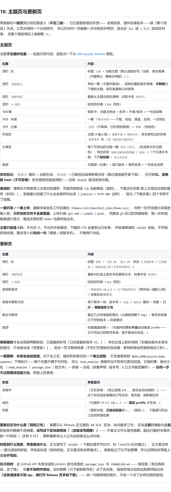

---

## 11. 动效与减少动态效果

### 母题：拼图块嵌进下一个槽

插件叫「拼图」，而它的核心动作本来就是拼图的动作：**一块东西从一个位置被挪到
它该在的位置，然后合上**。五列看板正是这个母题最直白的舞台——「未澄清 → 未接单
→ 在做 → 已做」本来就是把一块逐渐成形的拼图往成品里推。

全套动效由这一条语法生成，不是每处挑一个流行效果：

| 规则 | 内容 |
| --- | --- |
| **空间** | 对象**从它来的方向**进出。换页横向推（导航栏横向排列）；卡换列横向飞（列横向排列）；浮窗从面板内部长出（不位移） |
| **能量** | 输入**立即**被承认（按下即亮 / 卡片即时跟手），跟随与收尾才带动画。等待感只能来自真实等待 |
| **时间** | 高频 120ms / 出现 260ms / 跨列 320ms / 换页 200ms；**退场一律比入场短** |
| **变化** | 同一族曲线：进入 `ease-out`、退场 `ease-in`、整屏横移 `ease-in-out` |
| **禁用** | 见本节末尾「五条禁用规则」 |

### 有哪些动效

| 动效 | 用在哪 | 走什么 |
| --- | --- | --- |
| 面板入场 | 主区面板挂载时：淡入 + 上移 + 轻微缩放 | `dshpz-rise`，时长 `--dshpz-dur-in` |
| **换页转场** | 项目 / 主题 / 更新三页互切。**往右点从右侧进、返回从左侧进**（18px 位移 + 淡入）。转场那 200ms 里**整页锁住点击**（防点到相邻按钮），动画一结束就解锁 | `dshpz-page-in-right` / `dshpz-page-in-left`，时长 `--dshpz-dur-page`；锁定由 `data-nav` 非 0 触发，`animationend` + 260ms 定时器兜底复位 |
| 浮窗淡入 | 面板内浮窗（执行会话 / 澄清器 / 全局大脑 / 新建项目）与新建任务单浮窗出现时 | `dshpz-fade`，时长 `--dshpz-dur-in` |
| 子页切换 | 切「文档信息 / 派单系统」是**换主体**（不是叠一层浮层）；切回去时五维横条与模块条的**生长动画会重放一遍** | `.dshpz-dimfill` / `.dshpz-tilefill`（`dshpz-grow`），时长分别取 `--dshpz-dur-slow` 与 `--dshpz-dur-in` |
| 列表重排 FLIP | 一级项目列表新建后插行时，让已有的行**平滑让位** | JS 驱动（`flipList()`）+ `.dshpz-flip` 给过渡 |
| **卡片跨列飞行** | 看板上的卡换列时，**从旧列位置真的滑到新列位置**，途中极轻抬起（1.02） | JS 驱动（`travelCard()`）+ `.dshpz-cardtravel` 给过渡，时长 `--dshpz-dur-slow`；**同列换排不播** |
| **接收列「合上」** | 卡落进某一列时，那一列亮一下描边（**不位移**） | `.dshpz-boardcol[data-landed="1"]`（`dshpz-col-land`），时长 `--dshpz-dur-slow`，只播一次 |
| **按下触感** | 所有按钮 / 卡片 / 列表行 / 分段控件按下时内收 `scale(.97)` | `:active` 规则，80ms；松手弹回 180ms |
| **分段选中指示器** | 二级子页（文档信息 / 派单系统）选中格底线从中间向两侧展开 | `.dshpz-seg button::after`，`scaleX 0→1`，时长 `--dshpz-dur-fast` |
| **健康性数字爬升** | 健康性变化时，主读数从旧值爬到新值 | JS 驱动（`countUpValue()` + `HeroRing`），360ms，`cubicOut`；**首帧不爬** |
| 拖起来那张卡轻摇 | 拖拽时手上那张真卡一直轻轻摇 | `dshpz-cardsway`，1100ms，`ease-in-out`，**无限循环**（幅度很小：约 ±2°、位移 1px） |
| **拿起时的重量** | 拖拽时手上那张卡略放大（1.015）+ 投影变远变散 | JS 合成进 `transform`（`ghostAt()`），无过渡（要完全跟手） |
| 骨架屏扫光 | 加载占位块 | `dshpz-sheen`，1.3s 线性无限 |

### 两个关键实现要点

**为什么 FLIP 与跨列飞行要 JS 做**：重排时元素**换的是 DOM 位置**，而 `transform`
是相对自身原位的——位置一变，`transform` 也跟着变，CSS 根本不知道「它原来在哪」。
所以必须：先记旧位置 → 让 React 重排 → 再读新位置 → 用 `transform` 把它先拉回
旧位置 → 下一帧去掉 `transform` 让它过渡过去。

**「本帧不要过渡」必须用类，不能用行内样式**（这是 v2.4.17 修的一个真 bug）：
旧写法是 `node.style.transition = 'none'`，而行内优先级**高于类**，那行一直留着，
把类里的过渡整个压掉——于是元素**直接跳到终点**。也就是说列表重排的 FLIP
**从加进来那天起一次都没播过**，只是它退化得极其安静（行还是会移动，只是没有过程）。
现在用 `.dshpz-move-off` 这个类：加类 → 设起点 → 回流 → 摘类挂目标类 → 清 transform。

### 四档时长 + 三条曲线

| 令牌 | 默认值 | 用在哪 |
| --- | --- | --- |
| `--dshpz-dur-fast` | 120ms | 悬停、聚焦、按钮这类小范围状态切换 |
| `--dshpz-dur-page` | 200ms | **主视图切换**（比入场紧、比悬停慢） |
| `--dshpz-dur-in` | 260ms | 面板入场、浮窗淡入、小位移 |
| `--dshpz-dur-slow` | 320ms | **跨列移动**这类大位移 |

| 曲线 | 默认值 | 用在哪 |
| --- | --- | --- |
| `--dshpz-ease-out` | `cubic-bezier(.16,1,.3,1)` | 进入（快速出现、缓慢落定） |
| `--dshpz-ease-in` | `cubic-bezier(.55,.06,.68,.19)` | 退场（加速离开，果断） |
| `--dshpz-ease-in-out` | `cubic-bezier(.65,.05,.36,1)` | 整屏横移（两端都平滑） |

为什么需要四档：`fast` 与 `in` 都是给「小范围状态切换」定的；卡片跨列横跨几百像素，
260ms 会显得**跳**——眼睛跟不上落点，反而看不懂「它去哪了」。320ms 让位移有过程。
而换页整屏换主体，用 320ms 会像「等一场演出」，用 120ms 又像闪一下，200ms 刚好。

另一套内置风格（现代极简）把前四档调短一档，主题作者也可以改这几档。
性能红线：过渡只动 `transform` / `opacity`，不写 `top` / `left` / `margin` / 宽高——那会逐帧重排。

### 五条禁用规则

这一版的动效刻意**不做**这些（写进 CSS 注释里，约束以后每一次改动）：

1. **不做无限循环装饰**。例外只有两个：骨架微光与转圈圈——它们表达的是
   「真的在等」，不是装饰。
2. **不做滚动劫持**。滚动位置只当输入，不接管。
3. **不让动画改变命中区与焦点**。`scale` 只改绘制不改布局盒，所以按下去
   视觉上小了但手指/指针的判定范围不变（快速连点不会落空）。
4. **不用动画伪造进度、成功或 AI 的「思考」**。数字爬升的每个中间值都是
   曾经真实存在过的整数；没有真实百分比就不画百分比。
5. **同屏只允许一个主运动焦点**。看板上卡在飞的时候，列只做极轻的描边提示，
   不跟着一起动。

### 尊重系统的「减少动态效果」

| 侧 | 做法 |
| --- | --- |
| CSS | **作用域内通配**：`:where(.dshpz-scope)` 及其子树上的动画与过渡全部关掉、滚动行为改成 `auto` |
| JS | 拖拽跟手、轻摇、FLIP、跨列飞行、列落定、数字爬升这类 JS 动画**先问 `motionOn()`**（读 `matchMedia('(prefers-reduced-motion: reduce)')`），为真就**直接落位**、不摇也不播过渡 |

两个要点：

- **作用域是 `.dshpz-scope`**，它挂在**两个挂载点**上——主区面板根与侧边栏按钮
  （它们不在同一棵子树里，一个共同祖先罩不住）。写成白名单（逐个点名几个选择器）的话，
  以后新增的动效不会被自动关掉，所以必须是通配。
- **绝不写全局 `*`**：那会改掉整个宿主 UI 的动效，是越界。
- `motionOn()` **每次现读、不缓存**：你在会话中间改了系统设置，不必刷新页面。

**关掉动画会不会丢信息？** 这一版的动效**全部**只解释过程、不承载信息：
卡的位置是业务事实（不是动画）、数字的终值是真实值（不是爬升出来的）、
换页后的页面就在那里。所以统一关掉是安全的。加新动效时要先回答同一个问题：
**关掉它，用户会不会漏掉一件事？** 会 → 那件事不能只靠动画表达。

**但有一条例外，也是 v2.4.18 修的那个 bug**：换页转场的 `pointer-events:none`
**不只是视觉**，它会真的让面板点不了。而「减少动效」会把动画关掉、
`animationend` 就不来了——如果解锁只挂在动画事件上，那些用户会**永久点不了**。
所以这条锁必须有定时器兜底，不能只依赖动画生命周期。
**判断标准**：一个动效如果**改变了交互能力**（不只是观感），它就不能假设
「动画一定会正常播完」。这一类要单独审。

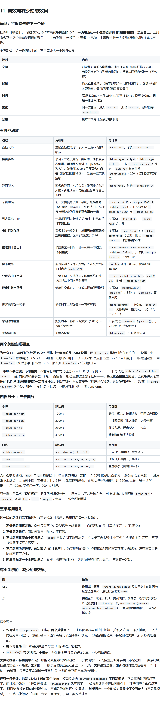

---

## 12. 窄屏（手机端）

断点只有一个：**900px**。判据是**窗口宽度**，不是「设备类型」——平板横竖屏、
桌面窄窗口都会跨过它，而判据是「五列挤不挤得下」，那件事只跟宽度有关。

| 位置 | 窄屏形态 |
| --- | --- |
| 一级页 | 本来就是单栏，不变 |
| 二级页两栏 | 纵向堆叠，栏间改横线分隔；面板自己滚动（不会出现「滚不到底」） |
| 二级页顶部 | `健康性 N%` **隐藏**（副标题里仍有模式与目录） |
| 看板 | 五列 → **单列 + 列标签切换 + 显式按钮，不做拖拽** |
| 主题页 | 卡片墙变单列，顶栏换行 |

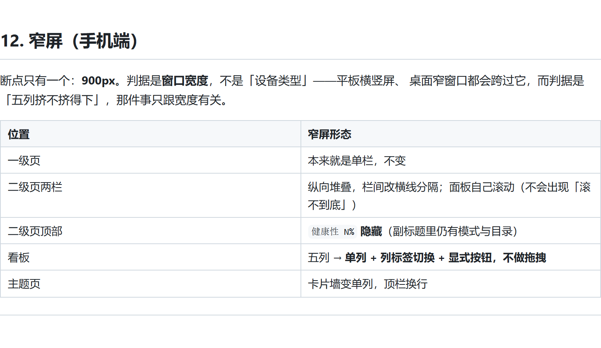

---

## 13. 两条常驻提醒

二级页左栏底部常驻两行：

1. **拼图文档只能由 AI 通过 `puzzle_mode` 改**；`write` / `edit` 会被文档锁拒绝（所有模式）。
   这道锁**不看会话装没装插件**——被拦的条件是路径落在已绑定数据工作区里某个项目的 `拼图/` 下。
   代价是一个完全不知道拼图模式的会话也会收到这句提示，换来的是文档不会被绕过锁改写。
2. **一轮最多 10 问、每题最多 10 个选项**。这两个数由宿主随状态下发，面板不自己写死；
   它们只是**给模型的软上限**（工具侧没有数量校验），真正的硬约束是固定的收尾问：
   每次提问的最后都问一次「要不要先停下？」，选项固定两项——
   `停下，等我看过再说` / `继续，不用停`。选第一项就是「只回写文档 + 一句话说明，本轮立即结束」。
   这个收尾问是**全局开关**（关掉后所有会话的提问都不再带它），但**面板上现在没有这颗开关**——
   要关就让 AI 调 `puzzle_mode` 的 `op:settings`。

除了上限，提示段还规定了**选项长什么样**：每题 3–6 个真岔路、每个配一句取舍，
并给了反例与正例；找岔路的五个维度是**做法 / 范围 / 时机 / 代价 / 取舍**。
所以点选项时你会看到**每个选项下面那行小字说明代价**。

> ⚠️ **与文档锁无关的另一件事，如实写在这里**：`只拼不写` 模式原本还会**拦下越权工具**
> （跑命令、改代码），这道拦截目前**没有生效**——模式名还写在文档里，但选它不会真的挡住写动作。
> 文档锁不受影响（它照常拦「直接改 `拼图/` 下的文档」）。

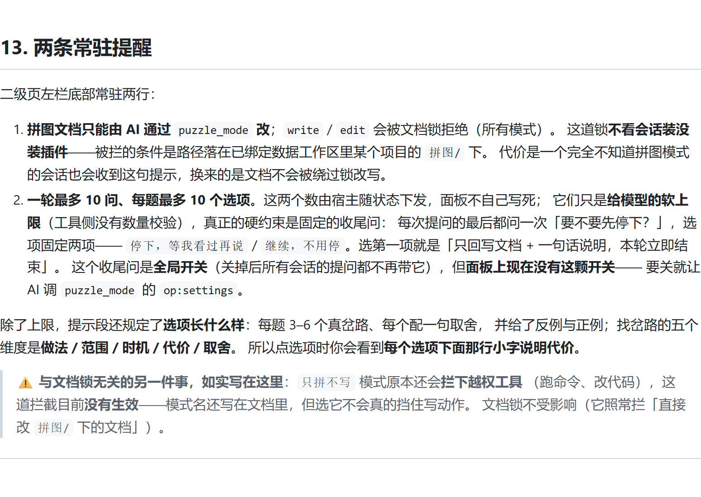

---

## 附：按钮总览（一屏速查）

**一级 · 拼图页**

```
顶：拼图 · <数据工作区路径>    [项目 | 主题 | 更新]   ⟳   ✕
数据工作区：<路径> + 更换工作区（N 个）▼ → 展开后一行一个（干净 / ⚠ N 个会话）→ 点一行即绑
项目：一行一个 → 名字 [当前] · 健康性 N% · N/M 模块 · 更新时间 · ›
      右上「＋ 新建项目」→ 三个输入框 + 立刻建 / 快速建空壳 / 采访后再建 + 取消
                        后两条起会话后在本面板弹浮窗（内嵌该会话的真实对话流）
派单设置（展开）：执行工作区实际路径 + 来源说明
                 根路径输入框（可留空 = 用项目文件夹）+ 保存 / 恢复默认
                 四个模型：创建任务卡（一键分解）/ 全局大脑 / 澄清器 / 执行会话
                           （下拉选宿主已配的模型 / 跟随默认 / 保存）
```

**二级 · 文档信息（拼图文档页）**

```
顶：拼图 · <项目名>   <模式> · 格式 v9 · <文档目录>   健康性 N%   [文档信息 | 派单系统]   ← 项目列表   ⟳   ✕
项目条：项目名 + 目录 · 主文档（只读查看，可收起）
左栏：健康性圆环（四档评语）· 五维 · 规模（小 / 中 / 大 + 当前上限）· 模块图块墙
      底：两条常驻提醒（文档锁 · 一轮 10 问 / 每题 10 个选项）
右栏：模块详情（五维 + 五组条目，默认全折叠）· 主文档只读
```

**二级 · 派单系统**

```
左上：全局大脑（常驻会话，已存在则复用）
五列：未澄清 ＋新建 | 未接单 | 在做 | 已做 | 失败
存储：一张卡一个文件 —— 拼图/<项目名>/派单/<卡 id>.json（改一张不碰另一张）
卡片：折叠成一行 —— [转圈圈] 标题 [未验收/失败角标]（悬停看需求原文）
      **卡上没有任何按钮**；点开浮窗看详情与动作
点卡：「在做」→ 执行会话浮窗 ｜「未澄清」有澄清会话 → 澄清器浮窗 ｜ 其余 → 卡详情浮窗
详情浮窗：目标 / 描述 / 需求原文 / 执行提示词 / 工作目录 / 两个会话 id / goal
          + 执行骨架 / 约束 / 验收判据 / 历史
          + 动作：→ 下一列 · 开始澄清 · 冻结 · ← 重做 · ← 重铸 / ← 回澄清 · 验收 · 删除 · 停
移动是唯一的手势：两个方向带副作用 ——「未澄清」拖到「未接单」= 自动开始澄清 + 弹浮窗
                    「未接单」拖到「在做」= 真的开工（建会话 + 挂 goal 30 轮 + 投消息）
拖起来：卡**真抓在手上** —— 跟着光标走（按抓取点，不是贴左上角）+ 轻轻摇
                   **原地那张同时隐藏**（不然像复制了一个，不像拿走了它）
拖到不接收的列：那一列**当场变样**（错误色 + 虚线），松手后手上那张**弹回原处**
                   「未澄清」不能直接到「已做」/「失败」——它们的意思都是"执行有了结论"
窄屏：单列 + 列标签，不拖拽，搬卡走详情浮窗里的「→ 下一列」
需求浮窗（＋ 新建）：一句话需求 → 一键分解（一次模型调用）→ 标题/目标/描述（可改）→ 创建
停：执行会话浮窗头部 + 卡详情浮窗各一颗 —— 只打断当前这一轮，goal 与卡都不动
收尾：执行完成 → 向全局大脑汇报 → 自动落「已做」或「失败」
      已做卡可验收 / 删除（连会话）· 失败卡可「← 重做」拖回在做
```

**主题页 / 更新页**（一级切换进入）

```
主题：恢复默认 · 刷新列表 · ← 返回 · 卡片墙（下载并应用 / 应用 / 卸载）
      开发区（建脚手架 + 填提示词 / 重算清单 / 上传）· 分享区（导出 / 导入并应用）
更新：重新检查 · ← 返回 · 一键更新到 vX.Y.Z / 只下载到暂存区 · 各版本更新日志 · 备份与暂存
```

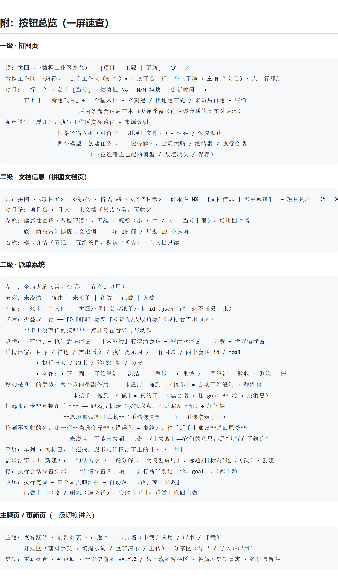
